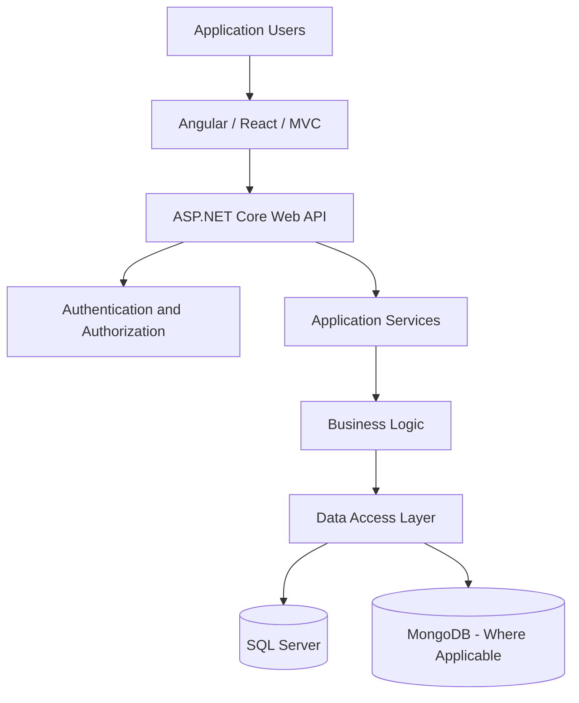

# Full Stack .NET Developer | Technical Portfolio

## Saurabh Kirulkar

**Full Stack .NET Developer | 4+ Years of Experience**

Pune, Maharashtra, India

[](https://www.linkedin.com/in/connectsaurabhk07)
[](https://github.com/Saurabhk0501)

---

## Professional Overview

Full Stack .NET Developer with 4+ years of experience,
including a paid internship, in designing, developing,
and maintaining enterprise web applications across
Banking & Finance, Healthcare, Real Estate,
and E-commerce domains.

Experienced in backend development, frontend engineering,
RESTful APIs, database optimization, secure application
development, and modern software delivery practices.

---

## Enterprise Project Case Studies

| Project | Domain | Technology Stack | Documentation |
|---|---|---|---|
| LoanFlow | Banking & Finance | ASP.NET Core, Angular, SQL Server | [View Case Study](projects/LoanFlow.md) |
| ShopStream | E-commerce | ASP.NET Core, React, TypeScript, SQL Server | [View Case Study](projects/ShopStream.md) |
| PropertyHub | Real Estate | ASP.NET MVC, React, SQL Server | [View Case Study](projects/PropertyHub.md) |
| MediTrack | Healthcare | ASP.NET Core, React, SQL Server, RabbitMQ | [View Case Study](projects/MediTrack.md) |

---

## Technical Documentation

### Enterprise System Architecture

Explore reference architecture designs covering Clean
Architecture, Microservices, RabbitMQ, Redis, application
security, SQL Server, cloud deployment, and CI/CD.

**[View System Architecture](architecture/System-Architecture.md)**

### Software Engineering Practices

Explore C#, SOLID principles, design patterns, RESTful APIs,
Entity Framework Core, SQL optimization, Angular, React,
ASP.NET MVC, automated testing, Docker, and Azure DevOps.

**[View Engineering Practices](engineering/Engineering-Practices.md)**

---
## Technical Publications

### Designing Scalable and Secure Enterprise Applications Using .NET 8, Clean Architecture, and Microservices

**Author:** Saurabh Kirulkar  
**Publication Year:** 2026  
**Publication Type:** Independent Technical White Paper

This white paper explores enterprise application architecture,
scalable microservices, REST API security, SQL Server
optimization, RabbitMQ, Redis, modern frontend integration,
and CI/CD practices.

- [View Publication Details](publications/README.md)
- [Read Technical White Paper (PDF)](publications/Saurabh_Kirulkar_Technical_White_Paper.pdf)

---


## Repository Structure

```text
dotnet-portfolio/
├── architecture/
│   └── System-Architecture.md
├── engineering/
│   └── Engineering-Practices.md
├── projects/
│   ├── LoanFlow.md
│   ├── MediTrack.md
│   ├── PropertyHub.md
│   └── ShopStream.md
└── README.md
```

---

## Portfolio Scope and Confidentiality

This portfolio contains professional project case studies,
independently prepared reference architectures, and
illustrative software engineering examples.

No proprietary company source code, customer information,
credentials, or confidential production infrastructure
details are disclosed.

Reference designs and code examples demonstrate technical
knowledge rather than verified production implementations.

---

---

## Technology Stack


| Category | Technologies |
|---|---|
| Backend | C#, .NET 8, ASP.NET Core, MVC, Web API |
| Frontend | Angular, React.js, TypeScript, Redux, RxJS |
| Database | SQL Server, MongoDB, EF Core, LINQ |
| Architecture | Microservices, Clean Architecture, SOLID |
| Security | JWT, OAuth, RBAC |
| Cloud & DevOps | Azure DevOps, Docker, AWS S3, CI/CD |
| Testing | xUnit, NUnit, Moq |
| Tools | Git, Bitbucket, Jira, Postman, Swagger |

---

## Professional Experience

| Company | Designation | Duration |
|---|---|---|
| Dev Information Technology Ltd. | Full Stack Developer | Sep 2026 - Present |
| Enrichepro Software Pvt. Ltd. | Full Stack .NET Developer | Sep 2024 - Jul 2026 |
| Outrival Software Solutions | Full Stack .NET Developer | Aug 2022 - Feb 2024 |
| Outrival Software Solutions | Software Developer Intern | Feb 2022 - Aug 2022 |

---

## Enterprise Project Showcase

### 01. LoanFlow - Loan & EMI Management System

**Domain:** Banking & Finance

**Organization:** Enrichepro Software Pvt. Ltd.

**Overview:**

Enterprise loan management system covering loan
applications, document submission, approval workflows,
EMI calculations, repayment schedules, and payment tracking.

**Technical Contributions:**

- RESTful API development
- Angular standalone components and reactive forms
- Loan processing and repayment workflows
- JWT authentication and role-based authorization
- SQL Server database operations

**Technology Stack:**

.NET 8, ASP.NET Core Web API, Angular,
TypeScript, RxJS, Entity Framework Core,
SQL Server, JWT.

---

### 02. ShopStream - E-commerce Platform

**Domain:** Retail & E-commerce

**Organization:** Enrichepro Software Pvt. Ltd.

**Overview:**

E-commerce platform covering product catalogs,
shopping carts, checkout, order processing,
order tracking, and inventory management.

**Technical Contributions:**

- React and TypeScript frontend development
- Redux Toolkit state management
- RESTful API development
- Inventory consistency and concurrency handling
- SQL Server database integration

**Technology Stack:**

ASP.NET Core Web API, React.js, TypeScript,
Redux Toolkit, Entity Framework Core, SQL Server.

---

### 03. PropertyHub - Property Management System

**Domain:** Real Estate

**Organization:** Outrival Software Solutions

**Overview:**

Property management platform supporting property
listings, tenants, leases, rental transactions,
maintenance requests, and financial reporting.

**Technical Contributions:**

- ASP.NET MVC administration portal
- React-based tenant portal
- Shared business service layer
- Property and lease management workflows
- Role-based access control

**Technology Stack:**

ASP.NET MVC, ASP.NET Web API, React.js,
Entity Framework Core, SQL Server.

---

### 04. MediTrack - Healthcare Management System

**Domain:** Healthcare

**Organization:** Outrival Software Solutions

**Role:** Software Developer Intern

**Overview:**

Healthcare management system covering patients,
doctors, appointments, medical records,
billing, and pharmacy operations.

**Technical Contributions:**

- Assisted in RESTful API development
- React frontend components
- CRUD operations
- SQL queries and data validation
- Application testing and debugging

**Technology Stack:**

ASP.NET Core Web API, React.js,
JavaScript, SQL Server.

---

## Illustrative Application Architecture



This diagram represents a generic logical architecture
for educational and portfolio documentation purposes.

---

## Software Engineering Practices

### Architecture

- Clean Architecture
- SOLID Principles
- Separation of Concerns
- Dependency Injection
- Reusable Application Services
- Microservices Architecture

### Security

- JWT Authentication
- OAuth
- Role-Based Access Control
- Input Validation
- Secure API Development

### Database Engineering

- Relational Database Design
- SQL Query Optimization
- Stored Procedures
- Entity Framework Core
- Database Migrations
- Transaction and Concurrency Handling

### DevOps

- Git Version Control
- Azure DevOps
- CI/CD Pipelines
- Docker Containers
- Agile/Scrum Development

### Testing

- Unit Testing
- Mocking Dependencies
- API Testing
- Functional Testing
- Debugging and Defect Resolution

---

## Portfolio Roadmap

- [ ] Detailed LoanFlow Case Study
- [ ] Detailed ShopStream Case Study
- [ ] Detailed PropertyHub Case Study
- [ ] Detailed MediTrack Case Study
- [ ] Project Architecture Documentation
- [ ] Independent Full Stack Demo Applications
- [ ] Automated Testing Examples
- [ ] CI/CD Demonstration

---

## Education

**Bachelor of Computer Science (B.C.S.)**

Shivaji University, Maharashtra | 2022

---

## Confidentiality Notice

This repository is a professional technical portfolio.

Enterprise project descriptions summarize professional
experience at a high level. Architecture diagrams are
illustrative and do not represent confidential production
architecture.

No proprietary company source code, client data,
credentials, or confidential implementation details
are included.

Independent demonstration projects will be identified
separately from professional company projects.

---

## Contact

- Email: saurabhkirulkar0501@gmail.com
- LinkedIn: [Saurabh Kirulkar](https://www.linkedin.com/in/connectsaurabhk07)
- GitHub: [Saurabhk0501](https://github.com/Saurabhk0501)
- Location: Pune, India

---

**Building secure, scalable, and maintainable enterprise applications.**
