# Enterprise System Architecture

## Overview

This document presents enterprise application architecture
and software engineering concepts across Banking & Finance,
E-commerce, Real Estate, and Healthcare domains.

It demonstrates full stack .NET development, architectural
patterns, frontend integration, database engineering,
application security, scalability, and DevOps practices.

---

## 1. Project Architecture Comparison

| Project | Domain | Frontend | Backend | Architecture |
|---|---|---|---|---|
| LoanFlow | Banking & Finance | Angular | ASP.NET Core Web API | Layered Architecture |
| ShopStream | E-commerce | React, TypeScript | ASP.NET Core Web API | Service-Based Architecture |
| PropertyHub | Real Estate | MVC, React | ASP.NET Web API | Shared Business Service Layer |
| MediTrack | Healthcare | React | ASP.NET Core Web API | Modular Layered Architecture |

These classifications represent illustrative reference designs.

---

## 2. Enterprise Application Architecture

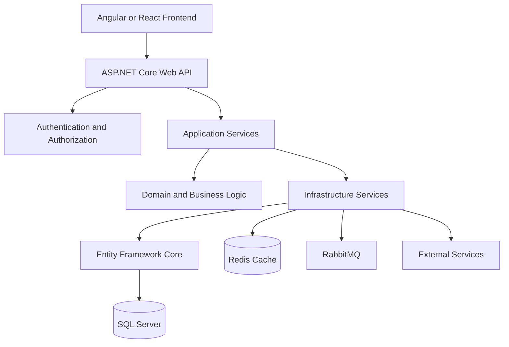

### Layer Responsibilities

| Layer | Responsibility |
|---|---|
| Presentation | User interface and interaction |
| API | HTTP request and response handling |
| Application | Business workflow coordination |
| Domain | Business entities and rules |
| Infrastructure | External service implementations |
| Data Access | Database operations |

---

## 3. Clean Architecture

Clean Architecture separates business logic from
frameworks, databases, and external dependencies.

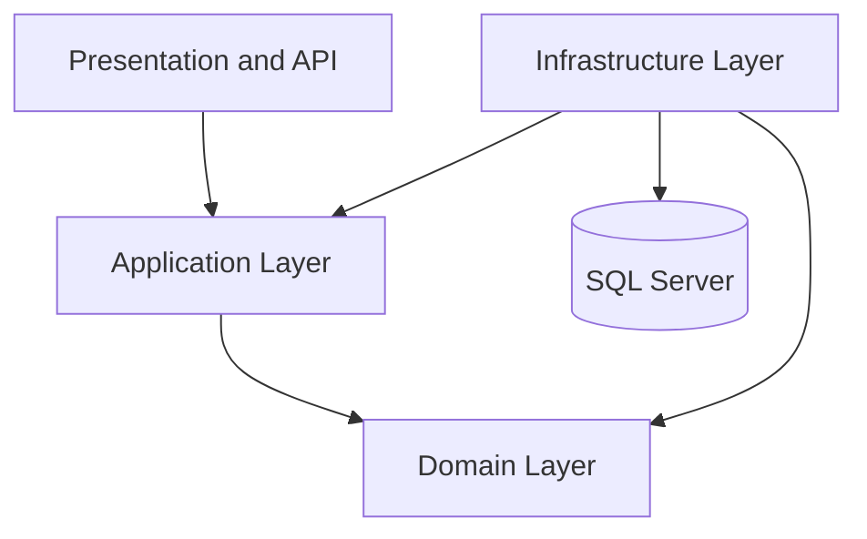

### Core Principles

- Separation of Concerns
- Dependency Inversion
- SOLID Principles
- Dependency Injection
- Independent Business Logic
- Maintainability and Testability
- Loose Coupling
- High Cohesion

### Reference .NET Solution Structure

```text
EnterpriseApplication/
├── src/
│   ├── EnterpriseApplication.API/
│   ├── EnterpriseApplication.Application/
│   ├── EnterpriseApplication.Domain/
│   └── EnterpriseApplication.Infrastructure/
├── tests/
│   ├── EnterpriseApplication.UnitTests/
│   └── EnterpriseApplication.IntegrationTests/
├── Dockerfile
├── docker-compose.yml
└── README.md
```

---

## 4. LoanFlow - Banking Architecture

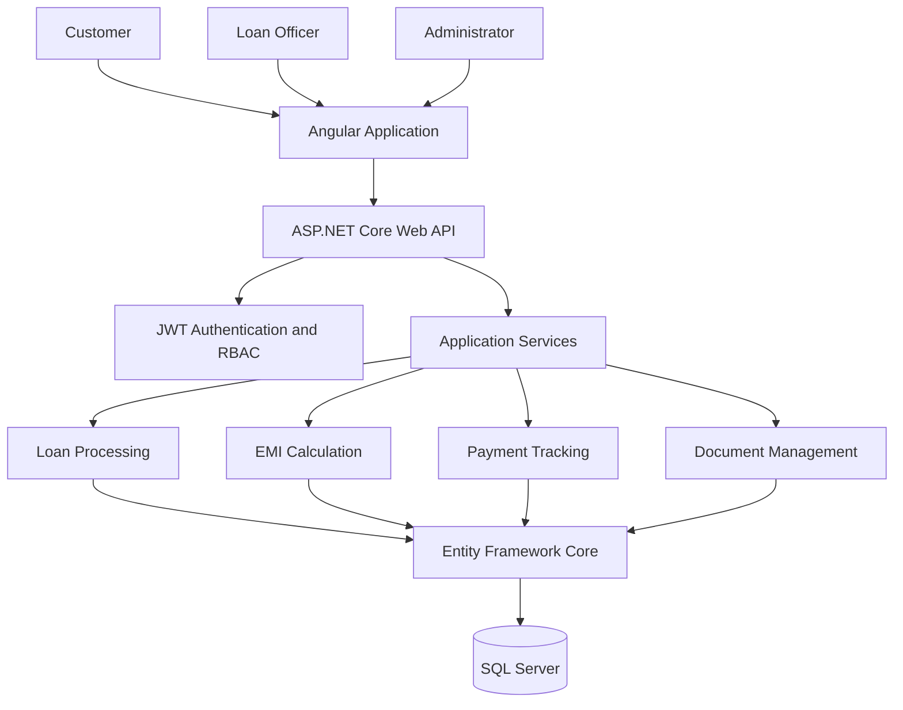

### Architectural Focus

- Angular standalone components
- Reactive forms and validation
- RxJS Observables
- Route guards and HTTP interceptors
- RESTful API development
- JWT authentication
- Role-based authorization
- Financial calculation accuracy
- Transactional data consistency

[View LoanFlow Case Study](../projects/LoanFlow.md)

---

## 5. ShopStream - E-commerce Architecture

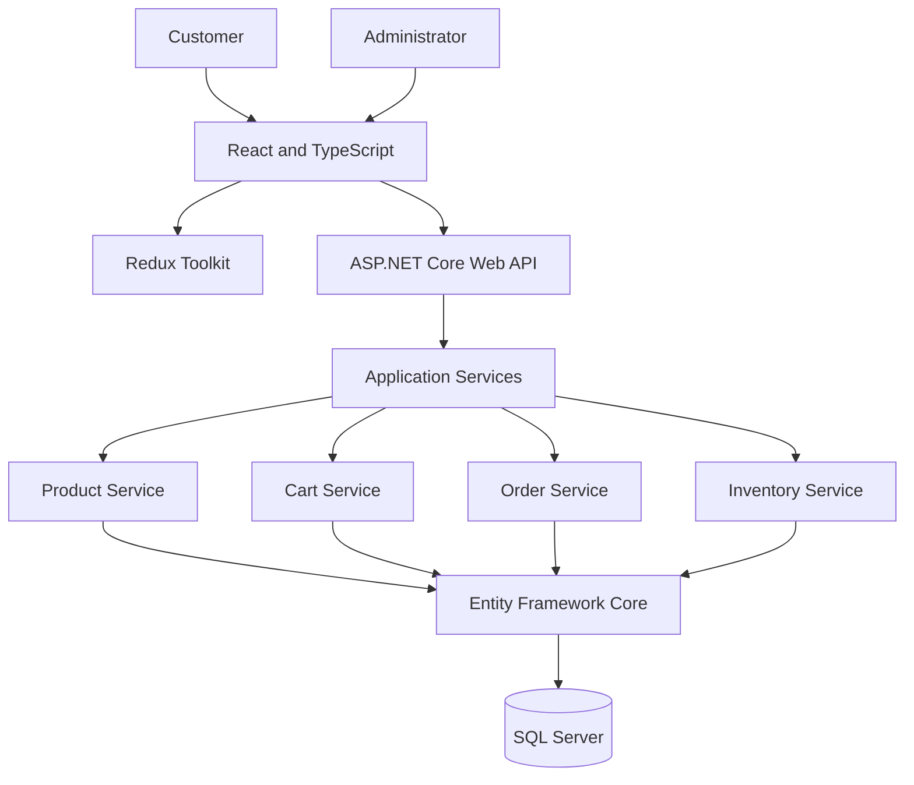

### Architectural Focus

- React functional components
- React Hooks
- TypeScript
- Redux Toolkit state management
- RESTful API integration
- Inventory concurrency control
- Transaction management
- Order processing consistency

[View ShopStream Case Study](../projects/ShopStream.md)

---

## 6. PropertyHub - Real Estate Architecture

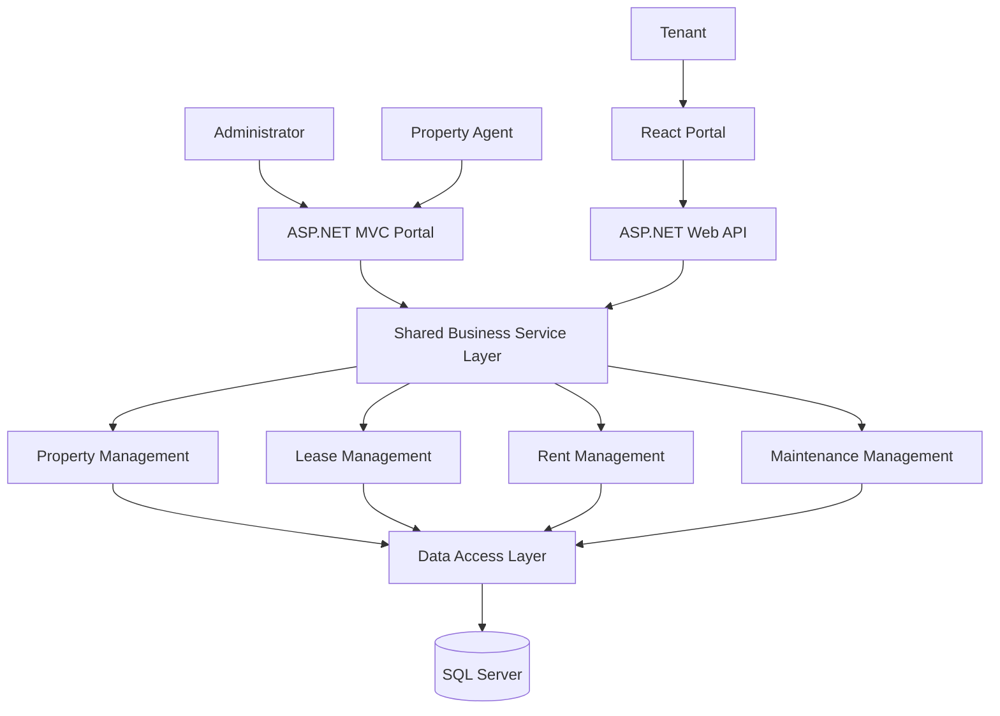

### Architectural Focus

- Model-View-Controller architecture
- Razor Views
- React frontend integration
- Shared business service layer
- Reusable business logic
- Role-based access control
- Rental transaction integrity
- Financial reporting

[View PropertyHub Case Study](../projects/PropertyHub.md)

---

## 7. MediTrack - Healthcare Architecture

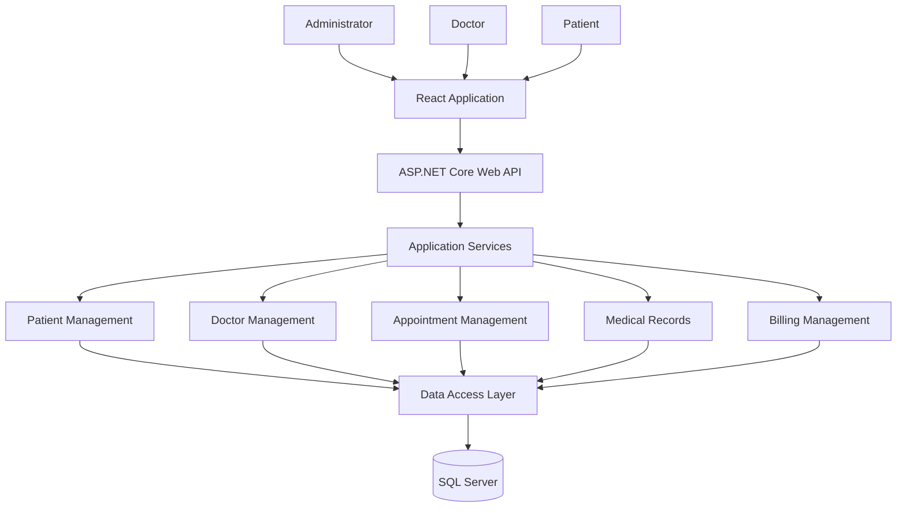

### Architectural Focus

- Modular healthcare workflows
- RESTful API development
- CRUD operations
- React component development
- Appointment scheduling
- SQL Server integration
- Patient information protection
- Relational data integrity

[View MediTrack Case Study](../projects/MediTrack.md)

---

## 8. Microservices Reference Architecture

The following independent reference architecture
demonstrates distributed application design using
ASP.NET Core, RabbitMQ, Redis, and an API Gateway.

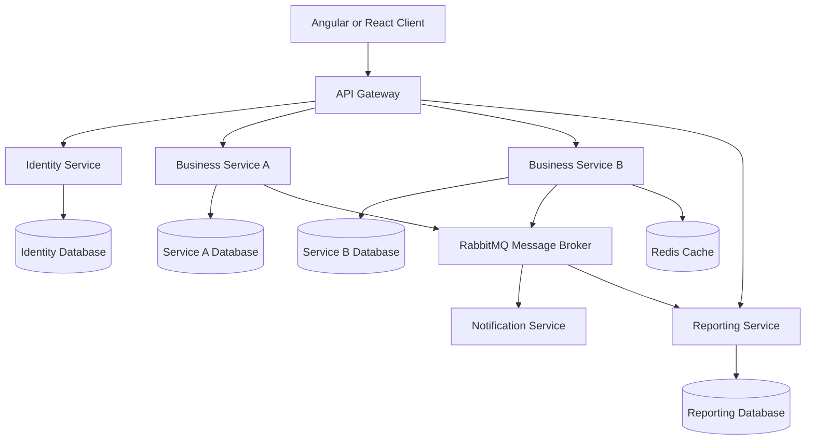

### Microservices Components

| Component | Responsibility |
|---|---|
| API Gateway | Request routing and centralized policies |
| Identity Service | Authentication and identity management |
| Business Services | Independent business capabilities |
| RabbitMQ | Asynchronous message communication |
| Redis | Distributed caching |
| Service Database | Independent service-owned persistence |
| Notification Service | Asynchronous notifications |
| Reporting Service | Reporting and analytical read models |

### Distributed System Considerations

- Independent service deployment
- Service-level scalability
- Event-driven communication
- Eventual consistency
- Idempotent message processing
- Retry and dead-letter policies
- Transactional outbox pattern
- Distributed logging
- Service failure isolation
- Health monitoring

Microservices should be adopted when their benefits
justify the additional operational complexity.

---

## 9. RabbitMQ Event-Driven Architecture

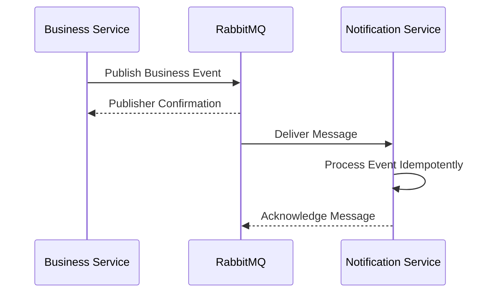

### Reference Use Cases

- Loan approval notifications
- Order confirmation notifications
- Rent payment reminders
- Appointment reminders
- Background business workflows

### Reliability Considerations

- Durable queues
- Publisher confirmations
- Consumer acknowledgements
- Retry policies
- Dead-letter queues
- Duplicate message handling
- Transactional outbox pattern

---

## 10. Redis Caching Architecture

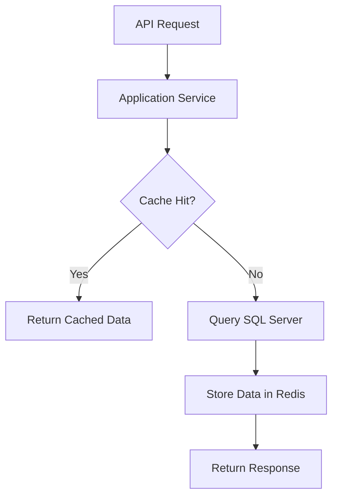

### Caching Considerations

- Cache-aside pattern
- Time-to-live configuration
- Cache invalidation
- Reduced database load
- Frequently accessed reference data
- Protection of sensitive information
- Appropriate cache consistency policies

Redis should not replace the authoritative database
for financial transactions or critical business records.

---

## 11. Authentication and Authorization

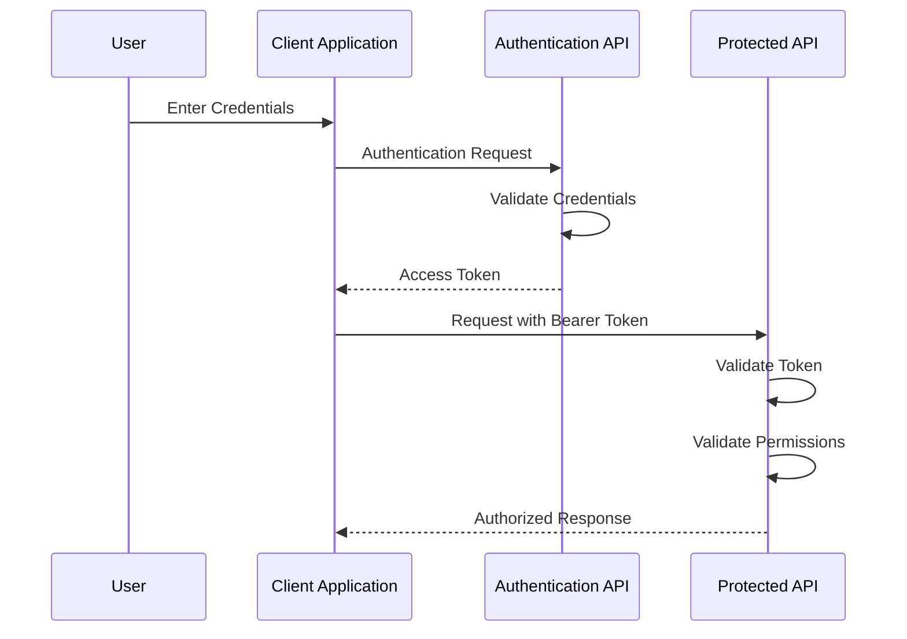

### Security Practices

- JWT-based authentication
- OAuth 2.0 authorization
- OpenID Connect authentication
- Role-based access control
- Policy-based authorization
- Resource ownership validation
- Secure token expiration
- HTTPS communication
- Server-side input validation
- Secure secret management
- Least privilege access

---

## 12. SQL Server Database Architecture

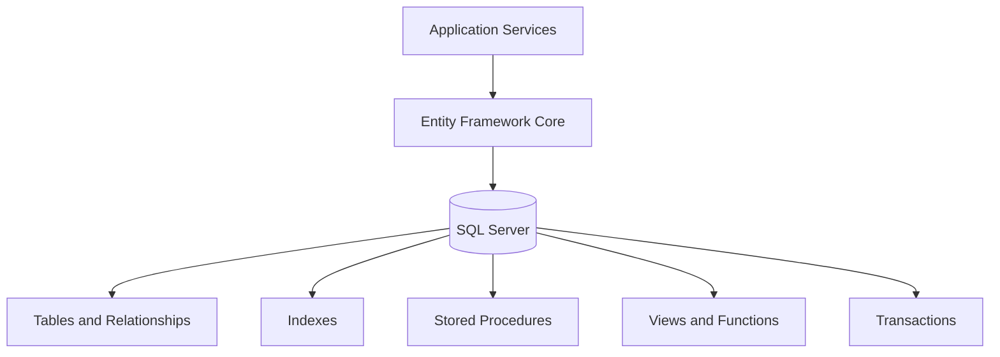

### Database Engineering Practices

- Relational database normalization
- Primary and foreign key constraints
- Clustered and non-clustered indexes
- Stored procedures and functions
- Parameterized SQL queries
- Query execution plan analysis
- Transaction management
- Optimistic concurrency control
- Controlled EF Core migrations
- Efficient pagination
- Data integrity validation

### Performance Considerations

- Avoid unnecessary database round trips.
- Retrieve only required columns.
- Apply appropriate indexes.
- Avoid N+1 query problems.
- Use asynchronous database operations.
- Analyze slow-running queries.
- Monitor blocking and deadlocks.
- Use caching where appropriate.

---

## 13. Azure DevOps CI/CD Architecture

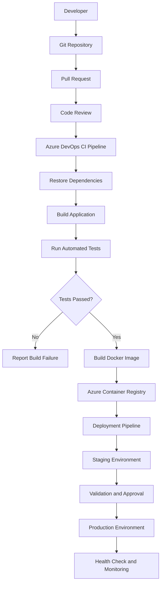

### CI/CD Practices

- Git-based version control
- Feature branches
- Pull request reviews
- Automated application builds
- Unit and integration testing
- Docker containerization
- Environment-specific configuration
- Azure Key Vault integration
- Secure deployment credentials
- Controlled database migrations
- Application health monitoring
- Deployment rollback strategy

---

## 14. Cloud Deployment Reference

### Microsoft Azure

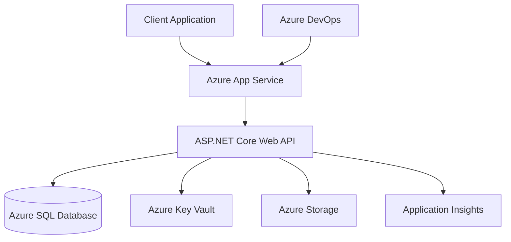

### AWS

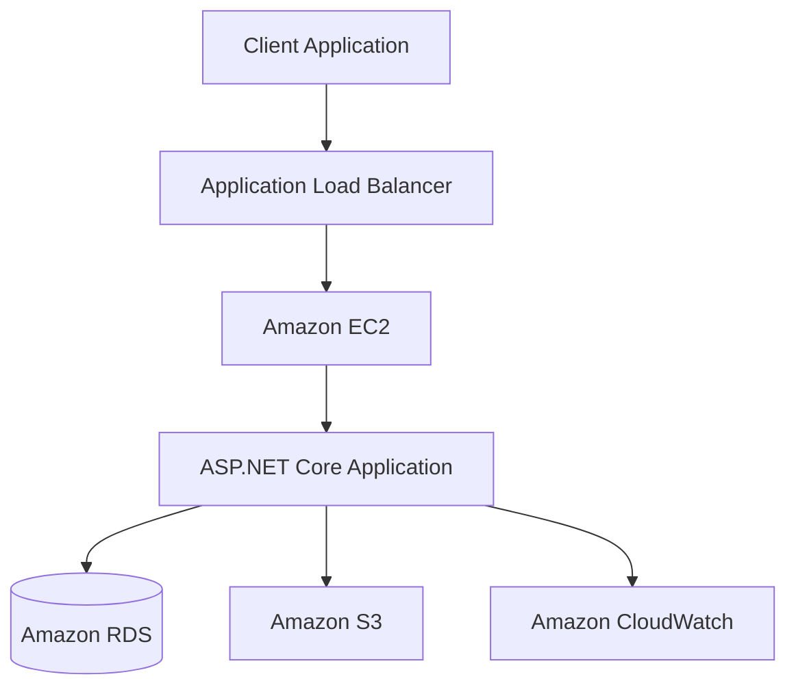

### Cloud Engineering Considerations

- Secure application hosting
- Environment configuration
- Secret management
- Application monitoring
- Database backups
- Scalability
- Availability
- Cost optimization

These diagrams demonstrate reference cloud deployment
options rather than verified production environments.

---

## 15. Application Testing Strategy

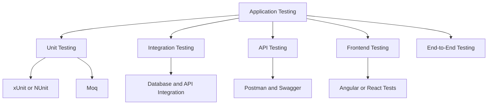

### Testing Objectives

- Validate business rules.
- Verify API responses.
- Validate database operations.
- Test authentication and authorization.
- Verify frontend behavior.
- Prevent regression defects.
- Improve application reliability.

---

## 16. Observability and Reliability

### Recommended Practices

- Structured application logging
- Global exception handling
- Correlation IDs
- Distributed tracing
- Application health checks
- API response time monitoring
- Database performance monitoring
- Appropriate retry policies
- Timeout and cancellation handling
- Centralized error reporting

---

## 17. Architecture Design Principles

| Principle | Objective |
|---|---|
| SOLID | Maintainable object-oriented design |
| DRY | Reduce unnecessary code duplication |
| KISS | Avoid unnecessary complexity |
| Separation of Concerns | Clear component responsibilities |
| Dependency Injection | Loose coupling and testability |
| Encapsulation | Protect internal implementation |
| High Cohesion | Group related functionality |
| Loose Coupling | Reduce component dependencies |
| Defense in Depth | Apply multiple security controls |

---

## 18. Architecture Trade-offs

| Pattern | Advantages | Considerations |
|---|---|---|
| Layered Architecture | Simple and maintainable | Potential layer coupling |
| Clean Architecture | Testability and independence | Additional abstractions |
| Modular Monolith | Simpler deployment | Shared deployment lifecycle |
| Microservices | Independent scaling and deployment | Distributed system complexity |
| Shared Service Layer | Reusable business logic | Shared dependency management |
| Event-Driven Architecture | Asynchronous communication | Eventual consistency |

Architecture selection should consider business
requirements, team size, security, maintainability,
deployment complexity, and application scale.

---

## 19. Technical Skills Demonstrated

| Category | Technologies and Concepts |
|---|---|
| Backend | C#, .NET 8, ASP.NET Core, MVC, Web API |
| Frontend | Angular, React, TypeScript, RxJS, Redux Toolkit |
| Database | SQL Server, Entity Framework Core, LINQ |
| Architecture | Clean Architecture, SOLID, Microservices |
| Messaging | RabbitMQ |
| Caching | Redis |
| Security | JWT, OAuth, RBAC |
| Cloud | Microsoft Azure, AWS |
| DevOps | Azure DevOps, Docker, CI/CD, Git |
| Testing | xUnit, NUnit, Moq, Postman |
| Methodology | Agile/Scrum |

---

## Confidentiality Notice

All architecture diagrams, database models, deployment
workflows, and technical examples in this document
are independently prepared illustrative reference designs.

They demonstrate software engineering knowledge and
architectural concepts without disclosing proprietary
company source code, production infrastructure,
customer information, credentials, or confidential
business information.

Reference designs are not claims of completed
production implementations or verified deployments.

---

## Author

**Saurabh Kirulkar**

Full Stack .NET Developer | 4+ Years of Experience

Pune, Maharashtra, India

- [GitHub Profile](https://github.com/Saurabhk0501)
- [LinkedIn Profile](https://www.linkedin.com/in/connectsaurabhk07)

---

[Back to Technical Portfolio](../README.md)

