# Software Engineering Practices

## Professional Overview

This document showcases enterprise software engineering
principles, architectural patterns, coding standards,
and technical practices relevant to Full Stack .NET
application development.

It complements the project case studies across Banking,
Healthcare, Real Estate, and E-commerce domains.

---

## 1. Technical Competencies

| Category | Technologies |
|---|---|
| Programming | C#, TypeScript, JavaScript, SQL |
| Backend | .NET 8, ASP.NET Core, MVC, Web API |
| Frontend | Angular, React.js, RxJS, Redux Toolkit |
| Database | SQL Server, PostgreSQL, MongoDB |
| Data Access | Entity Framework Core, LINQ, ADO.NET |
| Architecture | Clean Architecture, Microservices |
| Messaging | RabbitMQ |
| Caching | Redis |
| Security | JWT, OAuth 2.0, RBAC |
| Cloud | Microsoft Azure, AWS |
| DevOps | Azure DevOps, Docker, CI/CD |
| Testing | xUnit, NUnit, Moq |
| Tools | Git, Bitbucket, Jira, Postman, Swagger |
| Methodology | Agile/Scrum |

---

## 2. Object-Oriented Programming

| Principle | Description |
|---|---|
| Encapsulation | Protect internal object state |
| Abstraction | Expose essential functionality |
| Inheritance | Extend existing behavior |
| Polymorphism | Support interchangeable implementations |

### Engineering Objectives

- Reusable components
- Maintainable business logic
- Loose coupling
- High cohesion
- Improved extensibility
- Independent component testing

---

## 3. SOLID Principles

| Principle | Description |
|---|---|
| Single Responsibility | One reason for a class to change |
| Open/Closed | Open for extension, closed for modification |
| Liskov Substitution | Subtypes preserve expected behavior |
| Interface Segregation | Prefer focused interfaces |
| Dependency Inversion | Depend on abstractions |

### Reference Implementation

```csharp
public interface INotificationService
{
    Task SendAsync(
        string message,
        CancellationToken cancellationToken);
}

public sealed class OrderNotificationService
{
    private readonly INotificationService _notification;

    public OrderNotificationService(
        INotificationService notification)
    {
        _notification = notification;
    }

    public Task NotifyAsync(
        CancellationToken cancellationToken)
    {
        return _notification.SendAsync(
            "Order created successfully.",
            cancellationToken);
    }
}
```

This example demonstrates dependency inversion
and constructor injection.

---

## 4. Software Design Patterns

| Design Pattern | Reference Use Case |
|---|---|
| Repository | Abstract persistence operations |
| Unit of Work | Coordinate transactional operations |
| Factory | Create interchangeable implementations |
| Strategy | Select business calculation algorithms |
| Adapter | Integrate third-party services |
| Observer | Notify interested components |
| Mediator | Coordinate application requests |
| Decorator | Add caching, logging, or validation |

Design patterns should address actual engineering
requirements without introducing unnecessary complexity.

Entity Framework Core already provides repository-like
and unit-of-work behavior through DbSet and DbContext.

---

## 5. Clean Architecture

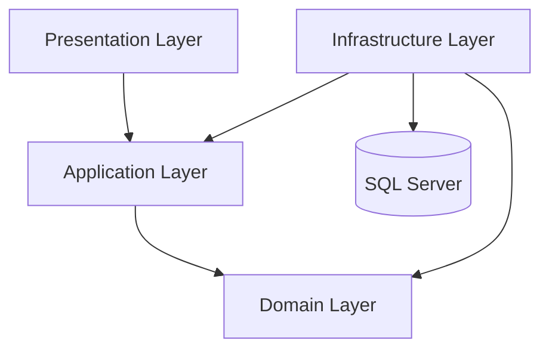

### Reference Solution Structure

```text
EnterpriseApplication/
├── src/
│   ├── Application.API/
│   ├── Application.Core/
│   ├── Application.Domain/
│   └── Application.Infrastructure/
├── tests/
│   ├── Application.UnitTests/
│   └── Application.IntegrationTests/
├── Dockerfile
├── docker-compose.yml
└── README.md
```

### Architecture Objectives

- Separation of concerns
- Independent business rules
- Framework-independent domain logic
- Dependency inversion
- Maintainability
- Testability

---

## 6. Dependency Injection

ASP.NET Core provides built-in dependency injection
for managing application dependencies.

```csharp
builder.Services.AddScoped<
    IProductService, ProductService>();
```

### Service Lifetimes

| Lifetime | Description |
|---|---|
| Transient | New instance for every resolution |
| Scoped | One instance per request scope |
| Singleton | One instance for application lifetime |

### Recommended Practices

- Prefer constructor injection.
- Avoid service locator patterns.
- Avoid injecting scoped services into singletons.
- Ensure singleton implementations are thread-safe.
- Register dependencies in the composition root.

---

## 7. RESTful API Development

### HTTP Methods

| Method | Purpose |
|---|---|
| GET | Retrieve resources |
| POST | Create resources |
| PUT | Replace resource representation |
| PATCH | Partially update resources |
| DELETE | Remove resources |

### HTTP Status Codes

| Code | Description |
|---|---|
| 200 | OK |
| 201 | Created |
| 204 | No Content |
| 400 | Bad Request |
| 401 | Unauthorized |
| 403 | Forbidden |
| 404 | Not Found |
| 409 | Conflict |
| 429 | Too Many Requests |
| 500 | Internal Server Error |

### API Development Standards

- Resource-oriented endpoint naming
- Request and response DTOs
- Server-side input validation
- Consistent error responses
- Pagination and filtering
- API versioning where required
- Swagger/OpenAPI documentation
- Asynchronous operations
- Cancellation token support

### Reference API Controller

```csharp
[ApiController]
[Route("api/products")]
[Authorize]
public sealed class ProductsController : ControllerBase
{
    private readonly IProductService _service;

    public ProductsController(IProductService service)
    {
        _service = service;
    }

    [HttpGet("{id:int}")]
    public async Task<ActionResult<ProductDto>> Get(
        int id,
        CancellationToken cancellationToken)
    {
        var product = await _service.GetByIdAsync(
            id,
            cancellationToken);

        if (product is null)
            return NotFound();

        return Ok(product);
    }
}
```

Supporting interfaces and models are omitted
for brevity.

---

## 8. Global Exception Handling

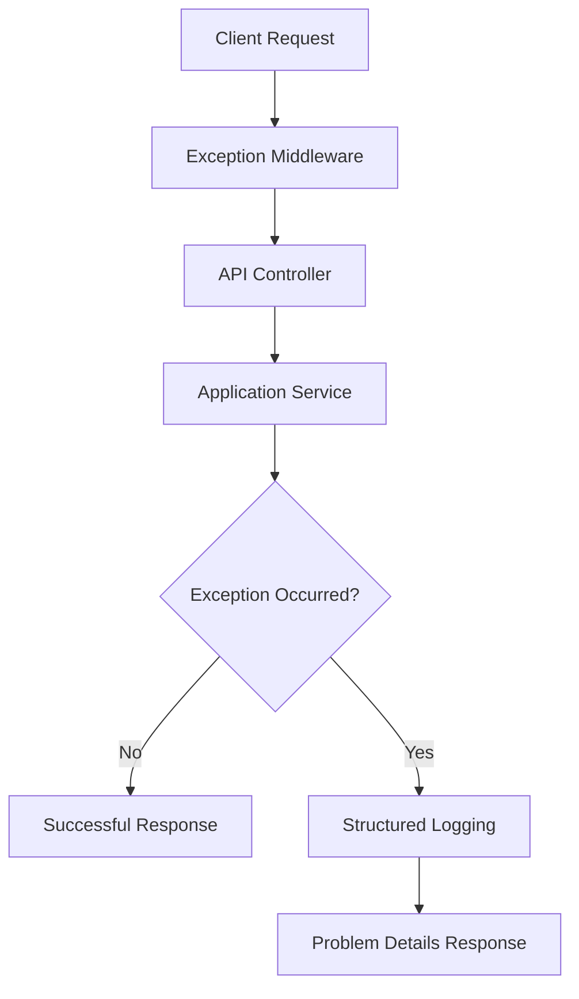

### Recommended Practices

- Centralized exception handling
- Consistent Problem Details responses
- Appropriate HTTP status codes
- Structured application logging
- Correlation IDs
- Sensitive information redaction
- No production stack traces in client responses

---

## 9. Entity Framework Core

### Recommended Practices

- Use asynchronous database operations.
- Use AsNoTracking for read-only queries.
- Retrieve only required columns.
- Prevent N+1 query problems.
- Apply appropriate transaction boundaries.
- Manage database migrations carefully.
- Handle optimistic concurrency conflicts.

### Reference Query

```csharp
var products = await dbContext.Products
    .AsNoTracking()
    .Where(p => p.IsActive)
    .OrderBy(p => p.Id)
    .Select(p => new ProductDto
    {
        Id = p.Id,
        Name = p.Name,
        Price = p.Price
    })
    .Skip(offset)
    .Take(pageSize)
    .ToListAsync(cancellationToken);
```

This query demonstrates projection, read-only
tracking behavior, and pagination.

Pagination parameters must be validated before execution.

---

## 10. SQL Server Performance Optimization

### Database Engineering Practices

- Database normalization
- Primary and foreign key constraints
- Clustered and non-clustered indexes
- Stored procedures
- Views, triggers, and functions
- Parameterized SQL queries
- Execution plan analysis
- Transaction management
- Efficient pagination
- Database statistics maintenance
- Blocking and deadlock monitoring

### Reference SQL Query

```sql
SELECT
    Id,
    CustomerId,
    TotalAmount,
    OrderDate
FROM Orders
WHERE CustomerId = @CustomerId
  AND OrderDate >= @StartDate
  AND OrderDate < @EndDate
ORDER BY OrderDate DESC;
```

### Reference Index

```sql
CREATE NONCLUSTERED INDEX
    IX_Orders_CustomerId_OrderDate
ON Orders (CustomerId, OrderDate DESC)
INCLUDE (Id, TotalAmount);
```

Index effectiveness should be validated using
actual execution plans and workload measurements.

---

## 11. Transaction and Concurrency Management

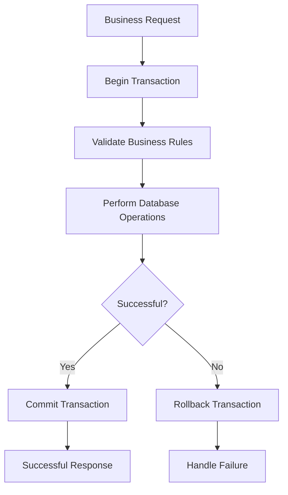

### Project-Specific Reference Scenarios

| Project | Data Integrity Requirement |
|---|---|
| LoanFlow | Consistent loan and EMI records |
| ShopStream | Prevent inventory overselling |
| PropertyHub | Prevent overlapping property leases |
| MediTrack | Prevent duplicate appointment bookings |

### Concurrency Techniques

- Optimistic concurrency using rowversion
- Atomic conditional updates
- Appropriate transaction isolation
- Unique database constraints
- Idempotent business operations

### Reference Inventory Update

```sql
UPDATE Products
SET StockQuantity = StockQuantity - @Quantity
WHERE Id = @ProductId
  AND @Quantity > 0
  AND StockQuantity >= @Quantity;
```

The application must verify the affected row count
and coordinate inventory and order updates within
an appropriate transaction.

---

## 12. Angular Engineering Practices

### Development Standards

- Standalone components where supported
- Reusable components and services
- Reactive forms
- Route guards
- HTTP interceptors
- RxJS Observables
- Lazy-loaded routes
- Subscription cleanup
- Error and loading state management
- Responsive user interfaces

### Reference Angular Structure

```text
src/app/
├── core/
│   ├── guards/
│   ├── interceptors/
│   └── services/
├── shared/
│   ├── components/
│   └── models/
├── features/
│   ├── authentication/
│   ├── dashboard/
│   └── loans/
└── app.routes.ts
```

### Application Flow

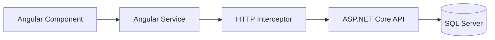

Client-side route guards do not replace
server-side authorization.

---

## 13. React Engineering Practices

### Development Standards

- Functional components
- React Hooks
- TypeScript interfaces
- Reusable UI components
- Redux Toolkit
- Appropriate local state management
- Route-based code splitting
- API service abstraction
- Loading and error state handling
- Responsive user interfaces

### Reference React Structure

```text
src/
├── components/
├── features/
│   ├── products/
│   ├── cart/
│   └── orders/
├── hooks/
├── pages/
├── services/
├── store/
├── types/
└── App.tsx
```

### Redux State Management

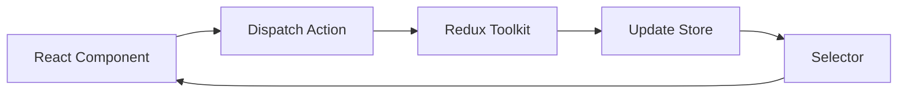

---

## 14. ASP.NET MVC Engineering Practices

### MVC Responsibilities

| Component | Responsibility |
|---|---|
| Model | Application data and business representation |
| View | User interface and presentation |
| Controller | Request handling and coordination |
| Service Layer | Business logic and workflows |
| Data Access Layer | Database operations |

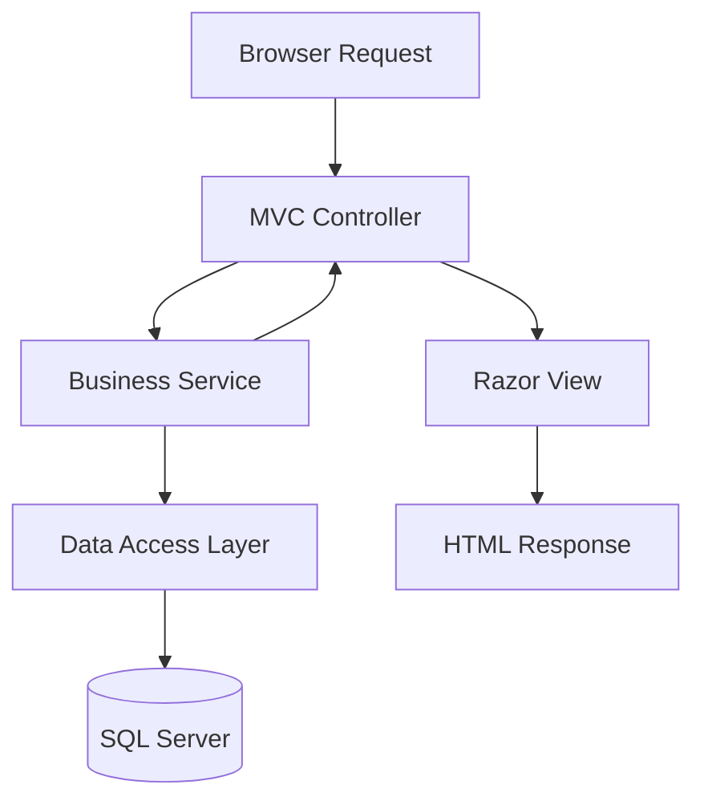

### Recommended Practices

- Keep controllers focused.
- Use strongly typed view models.
- Separate business logic from views.
- Apply server-side validation.
- Use anti-forgery protection.
- Reuse shared business services.
- Enforce authorization on protected actions.

---

## 15. Application Security

### Authentication and Authorization

- JWT signature and expiration validation
- Issuer and audience validation
- Role-based access control
- Policy-based authorization
- Resource ownership validation
- Secure password hashing
- OAuth 2.0 authorization
- OpenID Connect authentication

### Application Protection

- HTTPS enforcement
- Server-side input validation
- Parameterized SQL queries
- Cross-site scripting prevention
- CSRF protection where applicable
- Restricted CORS policies
- Rate limiting
- Secure secret management
- Least privilege access
- Sensitive data protection

### Reference Authorization

```csharp
[Authorize(Roles = "Admin")]
[HttpGet("reports")]
public IActionResult GetReports()
{
    return Ok();
}
```

Role checks should be combined with resource-level
authorization when accessing individual records.

---

## 16. Microservices Architecture

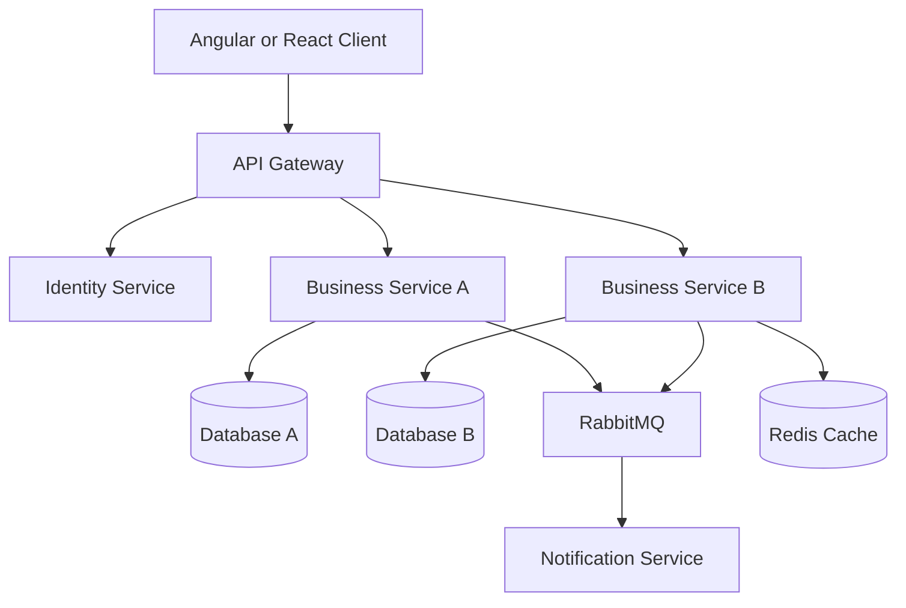

### Engineering Considerations

- Clear service boundaries
- Independent service deployment
- Service-owned data
- Asynchronous communication
- Eventual consistency
- Idempotent message processing
- Distributed tracing
- Service failure isolation
- Health monitoring

Microservices should be adopted when business
requirements justify distributed system complexity.

---

## 17. RabbitMQ Messaging

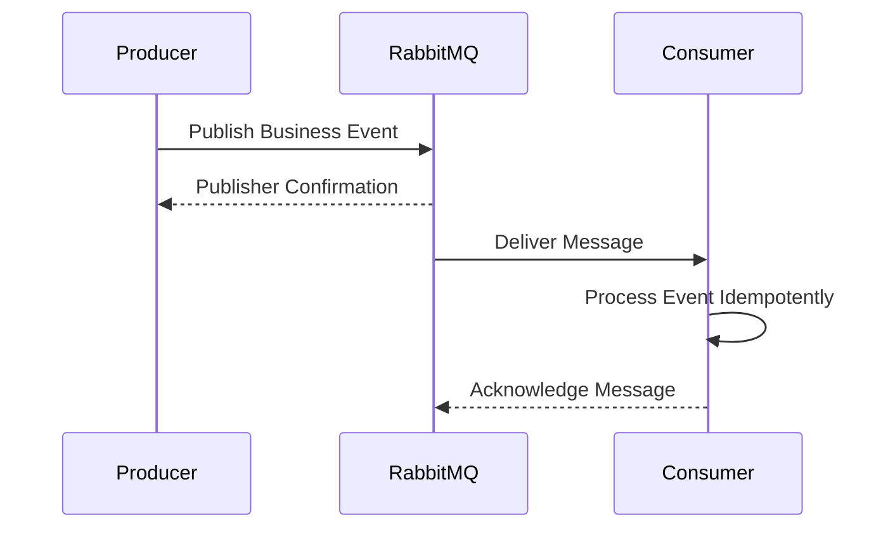

### Reference Use Cases

- Loan approval notifications
- Order confirmation notifications
- Rent payment reminders
- Healthcare appointment reminders

### Reliability Practices

- Durable queues
- Persistent messages
- Publisher confirmations
- Consumer acknowledgements
- Retry policies
- Dead-letter queues
- Transactional outbox pattern
- Message schema versioning
- Duplicate message handling

---

## 18. Redis Caching

### Cache-Aside Pattern

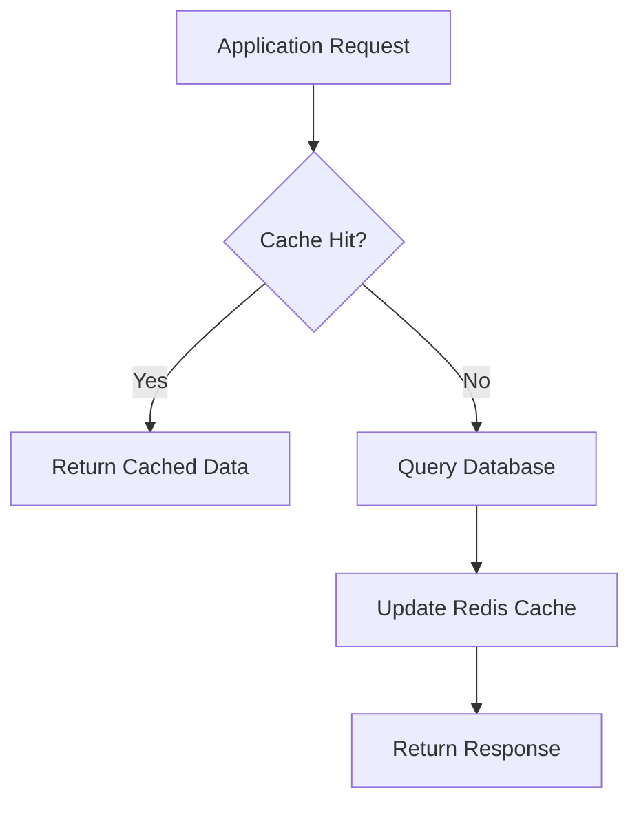

### Recommended Practices

- Configure appropriate expiration.
- Define cache invalidation rules.
- Monitor cache hit and miss rates.
- Avoid caching unnecessary sensitive data.
- Handle cache failures gracefully.
- Protect against cache stampedes.

The database remains the authoritative source
for critical financial and business records.

---

## 19. Unit and Integration Testing

### Reference Business Logic

```csharp
public static class OrderCalculator
{
    public static decimal CalculateTotal(
        decimal unitPrice,
        int quantity)
    {
        if (unitPrice < 0)
            throw new ArgumentOutOfRangeException(
                nameof(unitPrice));

        if (quantity <= 0)
            throw new ArgumentOutOfRangeException(
                nameof(quantity));

        return unitPrice * quantity;
    }
}
```

### Reference xUnit Tests

```csharp
public class OrderCalculatorTests
{
    [Theory]
    [InlineData(500, 3, 1500)]
    [InlineData(100, 2, 200)]
    public void CalculateTotal_ReturnsExpectedAmount(
        int price,
        int quantity,
        int expected)
    {
        var result = OrderCalculator.CalculateTotal(
            price,
            quantity);

        Assert.Equal((decimal)expected, result);
    }

    [Fact]
    public void CalculateTotal_InvalidQuantity_Throws()
    {
        Assert.Throws<ArgumentOutOfRangeException>(
            () => OrderCalculator.CalculateTotal(500m, 0));
    }
}
```

### Testing Strategy

| Testing Type | Purpose |
|---|---|
| Unit Testing | Validate isolated business logic |
| Integration Testing | Verify component interactions |
| API Testing | Validate HTTP endpoints |
| Database Testing | Verify persistence and constraints |
| Frontend Testing | Validate UI behavior |
| Regression Testing | Prevent existing feature failures |
| Performance Testing | Evaluate workload behavior |

### Testing Tools

- xUnit
- NUnit
- Moq
- Postman
- Swagger/OpenAPI

---

## 20. Git and Version Control

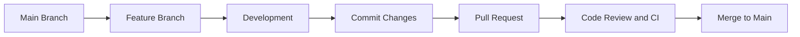

### Conventional Commit Examples

```text
feat: add loan approval workflow
fix: resolve inventory concurrency issue
refactor: improve application service structure
test: add order calculation tests
docs: update API documentation
perf: optimize database query
chore: update project dependencies
```

### Recommended Practices

- Small and focused commits
- Meaningful commit messages
- Pull request reviews
- Protected main branch
- Automated build validation
- Secure credential handling
- Appropriate .gitignore configuration

---

## 21. Docker Containerization

### Reference .NET 8 Dockerfile

```dockerfile
FROM mcr.microsoft.com/dotnet/sdk:8.0 AS build

WORKDIR /src

COPY . .

RUN dotnet restore

RUN dotnet publish -c Release -o /app/publish

FROM mcr.microsoft.com/dotnet/aspnet:8.0

WORKDIR /app

COPY --from=build /app/publish .

USER $APP_UID

EXPOSE 8080

ENTRYPOINT ["dotnet", "Application.API.dll"]
```

This is a simplified single-project reference
Dockerfile. Project paths and assembly names
must match the actual application.

### Container Engineering Practices

- Multi-stage builds
- Small runtime images
- Non-root execution
- Environment-specific configuration
- Secure secret injection
- Container health checks
- Dependency and image scanning

---

## 22. Azure DevOps CI/CD

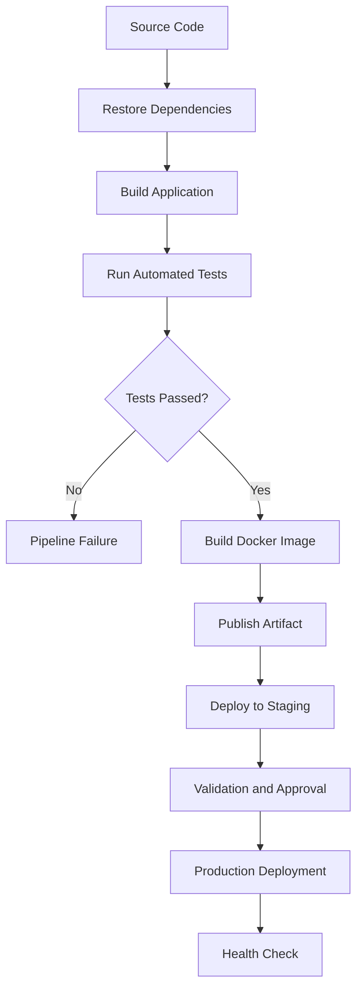

### Reference Azure Pipeline

```yaml
trigger:
  - main

pool:
  vmImage: ubuntu-latest

steps:
  - task: UseDotNet@2
    inputs:
      packageType: sdk
      version: '8.0.x'

  - script: dotnet restore
    displayName: Restore Dependencies

  - script: dotnet build --configuration Release --no-restore
    displayName: Build Application

  - script: dotnet test --configuration Release --no-build
    displayName: Run Automated Tests
```

This YAML demonstrates a basic continuous
integration pipeline.

Container publishing, deployment approvals,
database migrations, and production deployment
require project-specific configuration.

---

## 23. Cloud Engineering

### Microsoft Azure

| Service | Reference Purpose |
|---|---|
| Azure App Service | Web application hosting |
| Azure SQL Database | Managed relational database |
| Azure Key Vault | Secret management |
| Azure DevOps | CI/CD automation |
| Azure Container Registry | Container image storage |
| Application Insights | Application monitoring |

### Amazon Web Services

| Service | Reference Purpose |
|---|---|
| Amazon EC2 | Compute and application hosting |
| Amazon S3 | Object storage |
| AWS Lambda | Event-driven serverless processing |
| Amazon RDS | Managed relational database |
| Amazon CloudWatch | Logging and monitoring |

### Cloud Engineering Considerations

- Secure application hosting
- Environment configuration
- Secret management
- Application monitoring
- Database backups
- Scalability and availability
- Cost optimization

These services represent reference deployment
options rather than verified production environments.

---

## 24. Logging and Observability

### Recommended Practices

- Structured application logging
- Appropriate log levels
- Correlation IDs
- Distributed tracing
- Application health checks
- API latency monitoring
- Database performance monitoring
- Error rate monitoring
- Centralized log collection
- Sensitive information redaction

### Reference Logging

```csharp
_logger.LogInformation(
    "Order {OrderId} processed successfully.",
    orderId);
```

Structured logging supports filtering and analysis
using named properties.

---

## 25. Agile and Scrum Practices

### Software Delivery Lifecycle

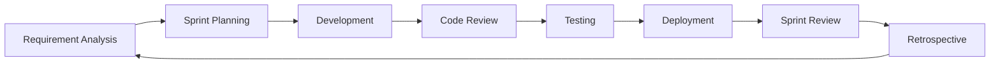

### Collaboration Practices

- Requirement analysis
- User story refinement
- Acceptance criteria validation
- Technical task estimation
- Sprint planning
- Daily stand-up meetings
- Code reviews
- Defect tracking
- Sprint demonstrations
- Sprint retrospectives

### Collaboration Tools

- Jira
- Bitbucket
- GitHub
- Azure DevOps

---

## 26. Code Review Checklist

### Backend Development

- [ ] Business requirements are satisfied.
- [ ] Code follows naming conventions.
- [ ] Responsibilities are clearly separated.
- [ ] Dependencies are managed appropriately.
- [ ] Input validation is implemented.
- [ ] Authorization is enforced.
- [ ] Exceptions are handled consistently.

### Frontend Development

- [ ] Components are reusable.
- [ ] State management is appropriate.
- [ ] Loading and error states are handled.
- [ ] Forms include validation.
- [ ] User interfaces are responsive.

### Database Development

- [ ] Queries are parameterized.
- [ ] Transactions are appropriate.
- [ ] Index requirements are evaluated.
- [ ] Data integrity is maintained.
- [ ] Database migrations are reviewed.

### Security and Testing

- [ ] Relevant automated tests are included.
- [ ] Sensitive information is protected.
- [ ] Credentials are not committed.
- [ ] Dependencies are reviewed.
- [ ] Build and test pipelines pass.

---

## 27. Project Case Studies

| Project | Domain | Engineering Focus |
|---|---|---|
| [LoanFlow](../projects/LoanFlow.md) | Banking & Finance | Angular, financial workflows, JWT |
| [ShopStream](../projects/ShopStream.md) | E-commerce | React, Redux, inventory concurrency |
| [PropertyHub](../projects/PropertyHub.md) | Real Estate | MVC, React, shared business services |
| [MediTrack](../projects/MediTrack.md) | Healthcare | Healthcare workflows, APIs, SQL Server |

### Related Documentation

- [Enterprise System Architecture](../architecture/System-Architecture.md)
- [Technical Portfolio Home](../README.md)

---

## Confidentiality and Implementation Notice

This document contains independently prepared
technical examples, illustrative architectural
patterns, and recommended engineering practices.

The examples are provided for technical portfolio
and educational purposes.

They do not represent proprietary company source
code, confidential production architecture,
verified deployments, or measured performance results.

No customer information, credentials, internal
infrastructure details, or confidential business
information are included.

Code snippets are illustrative and may require
supporting application configuration and dependencies.

---

## Author

**Saurabh Kirulkar**

Full Stack .NET Developer | 4+ Years of Experience

Pune, Maharashtra, India

- [GitHub Profile](https://github.com/Saurabhk0501)
- [LinkedIn Profile](https://www.linkedin.com/in/connectsaurabhk07)

---

[Back to Technical Portfolio](../README.md)

