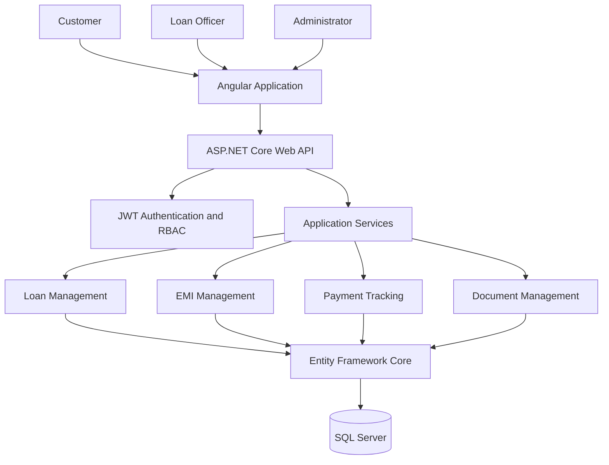
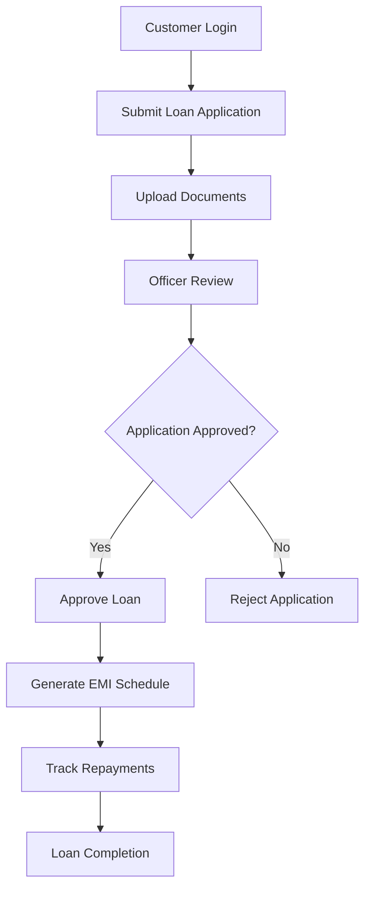
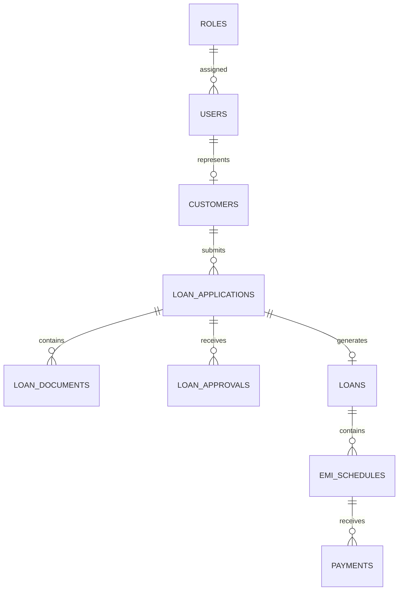

# LoanFlow - Loan & EMI Management System

## 1. Project Information

| Parameter | Details |
|---|---|
| Project Name | LoanFlow |
| Domain | Banking & Finance |
| Organization | Enrichepro Software Pvt. Ltd. |
| Role | Full Stack .NET Developer |
| Project Type | Enterprise Application |
| Frontend | Angular |
| Backend | ASP.NET Core Web API (.NET 8) |
| Database | Microsoft SQL Server |
| ORM | Entity Framework Core |
| Authentication | JWT |
| Authorization | Role-Based Access Control |

---

## 2. Project Overview

LoanFlow is an enterprise loan and EMI management
system designed to streamline loan applications,
document submission, approval workflows, EMI
calculations, repayment schedules, and payment tracking.

The application provides role-based access for
customers, loan officers, and administrators.

---

## 3. Business Objectives

- Streamline the loan application process.
- Simplify document submission and verification.
- Manage loan approval workflows.
- Automate EMI and repayment schedule calculations.
- Track loan repayment and payment status.
- Provide secure role-based application access.
- Improve operational efficiency and data consistency.

---

## 4. Technology Stack

### Backend

- C#
- .NET 8
- ASP.NET Core Web API
- Entity Framework Core
- LINQ
- RESTful APIs
- Dependency Injection

### Frontend

- Angular
- TypeScript
- RxJS
- Reactive Forms
- Standalone Components
- Route Guards
- HTTP Interceptors

### Database

- Microsoft SQL Server
- T-SQL
- Relational Database Design

### Security

- JWT Authentication
- Role-Based Authorization
- Input Validation

---

## 5. Functional Modules

### Customer Module

- Customer registration and authentication
- Loan application submission
- Document upload
- Application status tracking
- EMI schedule viewing
- Repayment history

### Loan Officer Module

- Review loan applications
- Verify submitted documents
- Process approval workflows
- Approve or reject applications
- Update application status

### Administrator Module

- User and role management
- Loan application monitoring
- Loan configuration
- Reporting and administrative operations

### EMI Management Module

- EMI calculation
- Repayment schedule generation
- Installment tracking
- Outstanding balance tracking

### Payment Management Module

- Payment record management
- Repayment status tracking
- Transaction history

---

## 6. Professional Contributions

- Developed RESTful APIs using ASP.NET Core Web API
  for loan applications and repayment workflows.

- Developed responsive Angular modules using
  standalone components, reactive forms, and RxJS.

- Implemented route guards and HTTP interceptors
  for authentication and secure API communication.

- Implemented JWT-based authentication and
  role-based authorization.

- Developed business logic for loan processing,
  EMI calculations, and repayment tracking.

- Implemented database operations using Entity
  Framework Core and Microsoft SQL Server.

- Contributed to application maintainability
  through reusable components and services.

---

## 7. Illustrative System Architecture

The architecture above is an illustrative logical
design for portfolio documentation purposes.

---

## 8. Illustrative Loan Approval Workflow

---

## 9. Reference Database Design

The following entities represent a simplified
conceptual database model.

| Entity | Responsibility |
|---|---|
| Users | User account information |
| Roles | Application roles |
| Customers | Customer information |
| LoanApplications | Loan application records |
| LoanDocuments | Submitted document metadata |
| LoanApprovals | Approval workflow records |
| Loans | Approved loan information |
| EMISchedules | Repayment installments |
| Payments | Payment transaction records |

### Conceptual Entity Relationship Diagram

---

## 10. Reference REST API Design

The following endpoints are illustrative examples
of RESTful API design for a loan management system.

| Method | Endpoint | Purpose |
|---|---|---|
| POST | /api/auth/login | User authentication |
| POST | /api/loans/applications | Submit application |
| GET | /api/loans/applications/{id} | Application details |
| GET | /api/loans/applications | List authorized applications |
| POST | /api/loans/applications/{id}/documents | Upload document |
| POST | /api/loans/applications/{id}/approve | Approve application |
| POST | /api/loans/applications/{id}/reject | Reject application |
| GET | /api/loans/{id}/emi-schedule | View EMI schedule |
| POST | /api/loans/{id}/payments | Record repayment |
| GET | /api/loans/{id}/payments | Payment history |

---

## 11. EMI Calculation Concept

EMI is calculated using the standard reducing
balance formula:

EMI = P × r × (1 + r)^n / ((1 + r)^n - 1)

Where:

- P = Principal loan amount
- r = Monthly interest rate in decimal format
- n = Number of monthly installments

For a zero-interest loan:

EMI = P / n

### Illustrative Calculation

| Parameter | Value |
|---|---|
| Loan Amount | INR 500,000 |
| Annual Interest Rate | 10% |
| Loan Tenure | 60 Months |
| Approximate Monthly EMI | INR 10,624 |

Actual repayment calculations depend on applicable
loan terms, rounding rules, fees, and interest policies.

---

## 12. Security Considerations

- JWT-based authentication
- Role-based API authorization
- Server-side input validation
- Protected customer information
- Secure document access
- Parameterized database operations
- Appropriate token expiration
- HTTPS communication

These are security design considerations for
a reference loan management application.

---

## 13. Recommended Testing Strategy

### Backend Testing

- Loan application validation
- EMI calculation accuracy
- Approval workflow validation
- Authorization checks
- Repayment tracking

### Frontend Testing

- Reactive form validation
- Route guard behavior
- API integration
- Error handling
- Role-based navigation

### API Testing

- Valid and invalid requests
- Authentication failures
- Unauthorized access
- Business rule validation

---

## 14. Engineering Principles

- Separation of Concerns
- SOLID Principles
- Dependency Injection
- Reusable Components
- RESTful API Design
- Maintainable Business Logic
- Relational Data Integrity

---

## 15. Potential Future Enhancements

- Automated EMI reminders
- Payment gateway integration
- Advanced financial reporting
- Background job processing
- Distributed caching
- Automated deployment pipelines

These enhancements are proposed ideas and are
not represented as completed project features.

---

## 16. Confidentiality Notice

LoanFlow represents professional project experience.

This case study contains high-level functional
descriptions and illustrative technical designs.

Database models, API endpoints, architecture diagrams,
and calculation examples are reference designs and
do not disclose proprietary production implementations.

No confidential company source code, customer data,
credentials, or internal business information is included.

---

## Author

**Saurabh Kirulkar**

Full Stack .NET Developer

- GitHub: [Saurabhk0501](https://github.com/Saurabhk0501)
- LinkedIn: [Saurabh Kirulkar](https://www.linkedin.com/in/connectsaurabhk07)

[Back to Technical Portfolio](../README.md)
