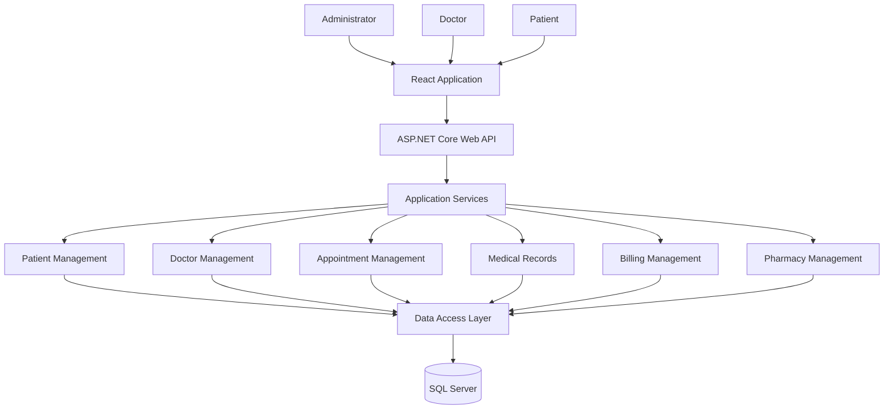
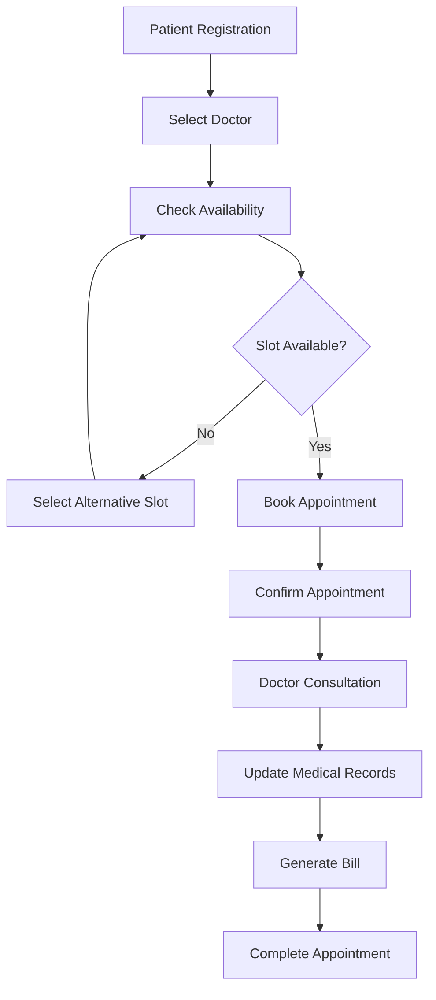
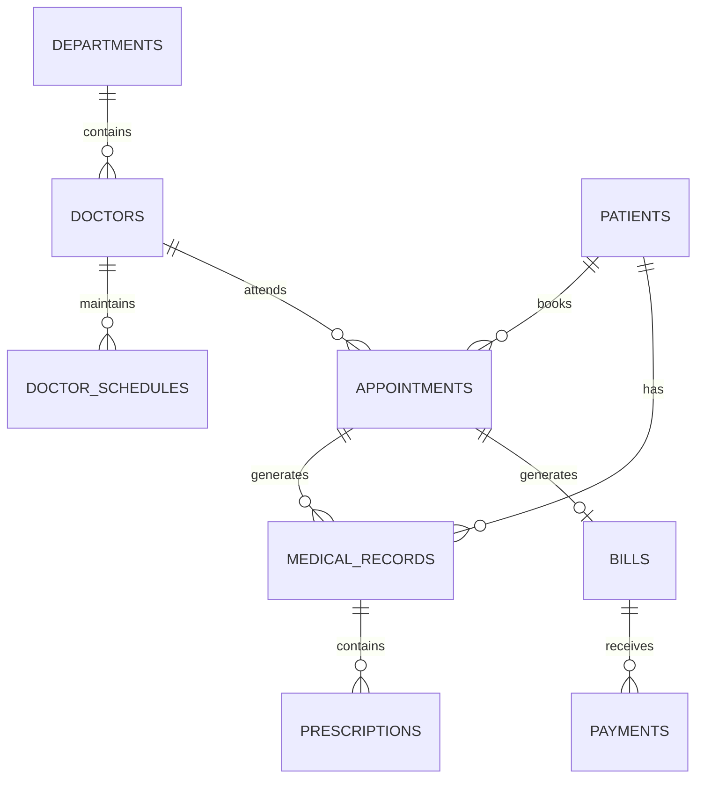
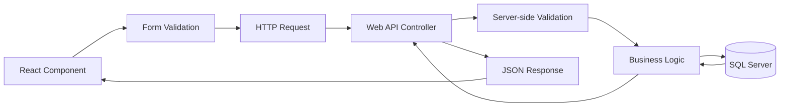

# MediTrack - Healthcare Management System

## Project Information

| Parameter | Details |
|---|---|
| Domain | Healthcare |
| Organization | Outrival Software Solutions |
| Role | Software Developer Intern |
| Project Type | Enterprise Web Application |
| Frontend | React.js |
| Backend | ASP.NET Core Web API |
| Database | Microsoft SQL Server |
| Methodology | Agile/Scrum |

## Project Overview

MediTrack is a healthcare management system designed
to streamline patient registration, doctor management,
appointment scheduling, medical records, billing,
and pharmacy operations.

The project provided practical exposure to full stack
development, RESTful APIs, database operations, testing,
and debugging under senior developer guidance.

## Technology Stack

- C#, ASP.NET Core Web API
- React.js, JavaScript
- HTML5, CSS3
- Microsoft SQL Server
- SQL Queries and Stored Procedures
- RESTful APIs
- Git, Postman, Visual Studio, SSMS

## Key Functional Modules

- Patient Management
- Doctor Management
- Appointment Scheduling
- Medical Records
- Prescription Management
- Billing Management
- Pharmacy Management
- Administration Dashboard

## Roles and Responsibilities

- Assisted in developing RESTful APIs.
- Developed basic CRUD operations.
- Assisted in developing React frontend components.
- Contributed to patient and appointment workflows.
- Wrote SQL queries and stored procedures.
- Assisted in frontend and backend data validation.
- Participated in application testing and debugging.
- Gained practical experience with Git version control.
- Collaborated with senior developers in Agile sprints.

## Illustrative System Architecture



## Appointment Booking Workflow



## Reference Database Design



## Reference REST API Endpoints

| Method | Endpoint | Purpose |
|---|---|---|
| GET | /api/patients | Authorized patient list |
| GET | /api/patients/{id} | Patient details |
| POST | /api/patients | Register patient |
| PUT | /api/patients/{id} | Update patient |
| GET | /api/doctors | Doctor list |
| GET | /api/doctors/{id}/availability | Doctor availability |
| POST | /api/appointments | Book appointment |
| GET | /api/appointments/{id} | Appointment details |
| PATCH | /api/appointments/{id}/status | Update status |
| GET | /api/patients/{id}/medical-records | Medical history |
| POST | /api/bills | Generate bill |
| GET | /api/bills/{id} | Billing details |

## Reference SQL Query

Retrieve upcoming appointments for a selected doctor.

```sql
SELECT
    a.Id AS AppointmentId,
    p.FullName AS PatientName,
    a.AppointmentDateTime,
    a.Status
FROM Appointments a
INNER JOIN Patients p
    ON a.PatientId = p.Id
WHERE a.DoctorId = @DoctorId
  AND a.AppointmentDateTime >= SYSUTCDATETIME()
  AND a.Status = 'Scheduled'
ORDER BY a.AppointmentDateTime;
```

This example assumes appointment timestamps are stored
in UTC and access is restricted to authorized users.

## Frontend and Backend Integration



## Appointment Data Integrity

- Validate patient and doctor information.
- Validate appointment date and time.
- Verify doctor availability.
- Prevent duplicate bookings.
- Prevent overlapping appointments.
- Maintain valid appointment status transitions.

## Security and Privacy Considerations

- Secure authentication
- Role-based authorization
- Resource ownership validation
- Server-side input validation
- Protected medical records
- Parameterized SQL queries
- HTTPS communication
- Audit logging and least privilege access

These are reference security considerations,
not claims of regulatory certification.

## Recommended Testing Strategy

- Patient registration testing
- CRUD operation testing
- Appointment validation
- Doctor availability testing
- Duplicate booking prevention
- React component testing
- SQL query validation
- REST API integration testing

## Learning Outcomes

- C# and ASP.NET Core development
- RESTful API implementation
- React frontend development
- SQL Server database operations
- Application debugging
- Software testing
- Git version control
- Agile/Scrum collaboration
- Enterprise application development practices

## Potential Enhancements

- RabbitMQ-based asynchronous notifications
- Automated appointment reminders
- Email and SMS notifications
- Background job processing
- Redis distributed caching
- Docker-based deployment
- Automated CI/CD pipelines

These are proposed enhancements and are not
represented as completed internship contributions.

## Confidentiality Notice

This case study summarizes professional internship experience.
Architecture diagrams, database models, SQL examples,
and API endpoints are illustrative reference designs.

No proprietary source code, patient information,
medical records, or confidential company data is included.

## Author

**Saurabh Kirulkar | Full Stack .NET Developer**

[GitHub](https://github.com/Saurabhk0501) |
[LinkedIn](https://www.linkedin.com/in/connectsaurabhk07)

[Back to Technical Portfolio](../README.md)

