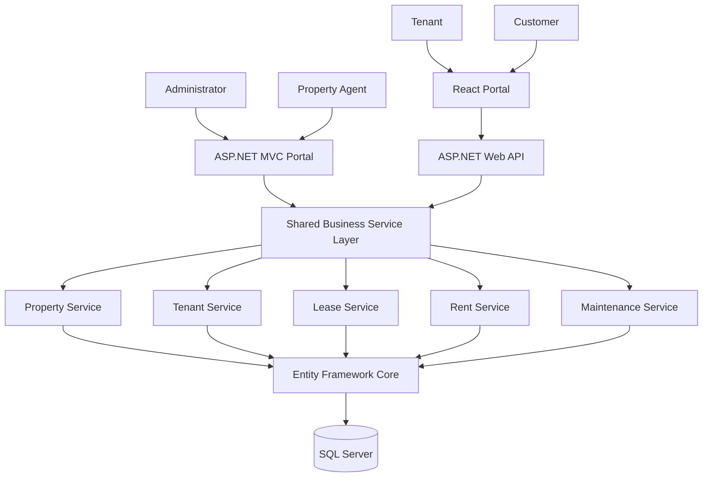
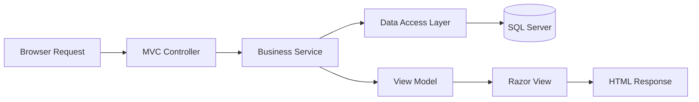
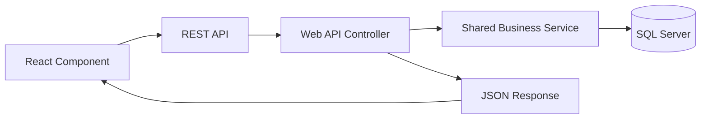
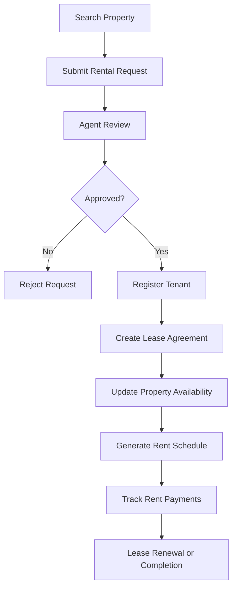
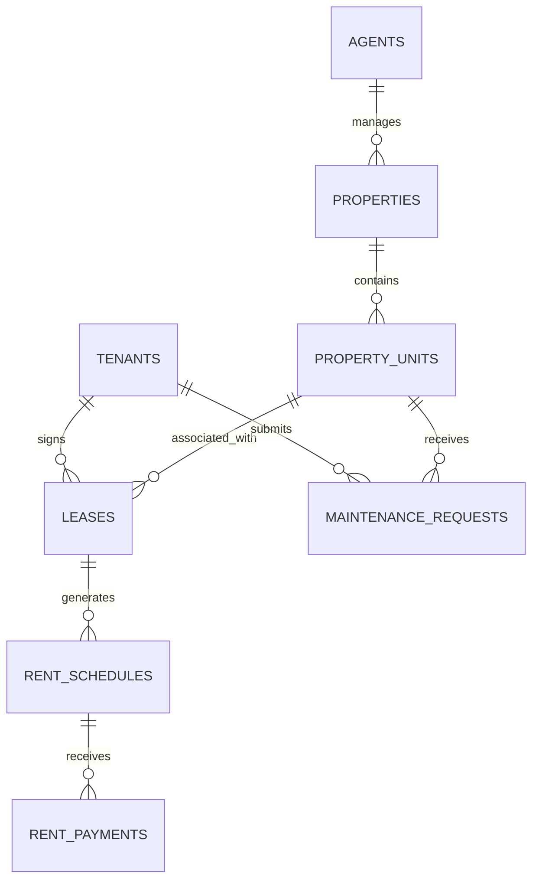

# PropertyHub - Property Management System

## Project Information

| Parameter | Details |
|---|---|
| Domain | Real Estate |
| Organization | Outrival Software Solutions |
| Role | Full Stack .NET Developer |
| Project Type | Enterprise Web Application |
| Admin Portal | ASP.NET MVC |
| Tenant Portal | React.js |
| Backend | ASP.NET Web API |
| Database | Microsoft SQL Server |
| ORM | Entity Framework Core |
| Architecture | Shared Business Service Layer |

## Project Overview

PropertyHub is a property management platform designed
to streamline property listings, tenant management,
lease agreements, rental transactions, maintenance
requests, and financial reporting.

The application combines an ASP.NET MVC administration
portal with a React-based tenant portal supported by
a shared business service layer.

## Technology Stack

- C#, ASP.NET MVC, ASP.NET Web API
- React.js, JavaScript
- Razor Views, HTML5, CSS3
- SQL Server, Entity Framework Core, LINQ
- Stored Procedures
- RESTful APIs
- Role-Based Access Control

## Key Functional Modules

- Property Listings and Search
- Property Unit Management
- Tenant Management
- Agent Management
- Lease Management
- Rent Tracking
- Maintenance Management
- Financial Reporting
- Administration Dashboard

## Roles and Responsibilities

- Developed ASP.NET MVC administration modules.
- Developed React-based tenant portal components.
- Implemented reusable business services.
- Developed RESTful APIs for frontend integration.
- Contributed to property, tenant, and lease workflows.
- Developed rental payment and maintenance operations.
- Implemented database operations using SQL Server and EF Core.
- Contributed to role-based access control.
- Participated in debugging and application maintenance.

## Illustrative System Architecture



## MVC Request Lifecycle



## React Portal Integration



## Property Rental Workflow



## Reference Database Design



## Reference REST API Endpoints

| Method | Endpoint | Purpose |
|---|---|---|
| GET | /api/properties | Property listings |
| GET | /api/properties/{id} | Property details |
| POST | /api/properties | Create property |
| PUT | /api/properties/{id} | Update property |
| POST | /api/tenants | Register tenant |
| POST | /api/leases | Create lease |
| GET | /api/leases/{id} | Lease details |
| GET | /api/leases/{id}/rent-schedule | Rent schedule |
| POST | /api/rent-payments | Record payment |
| POST | /api/maintenance-requests | Submit request |
| PATCH | /api/maintenance-requests/{id}/status | Update status |
| GET | /api/reports/rental-income | Financial report |

## Reference Role-Based Access Control

| Feature | Admin | Agent | Tenant | Customer |
|---|---|---|---|---|
| Manage Properties | Yes | Assigned | No | No |
| View Properties | Yes | Yes | Yes | Yes |
| Manage Leases | Yes | Assigned | No | No |
| View Own Lease | N/A | N/A | Yes | No |
| Record Rent | Yes | Assigned | No | No |
| View Own Payments | N/A | N/A | Yes | No |
| Maintenance Requests | Yes | Yes | Yes | No |
| Financial Reports | Yes | Restricted | No | No |

## Reference SQL Financial Report

```sql
SELECT
    rs.LeaseId,
    SUM(rs.AmountDue) AS TotalDue,
    SUM(COALESCE(p.AmountPaid, 0)) AS TotalPaid,
    SUM(rs.AmountDue)
        - SUM(COALESCE(p.AmountPaid, 0))
        AS OutstandingBalance
FROM RentSchedules rs
LEFT JOIN
(
    SELECT
        RentScheduleId,
        SUM(Amount) AS AmountPaid
    FROM RentPayments
    GROUP BY RentScheduleId
) p ON rs.Id = p.RentScheduleId
GROUP BY rs.LeaseId;
```

Payment records are aggregated before joining to
avoid duplicate scheduled amounts.

## Data Integrity Considerations

- Prevent overlapping active leases.
- Validate property availability.
- Validate lease start and end dates.
- Maintain accurate rental payment records.
- Apply transactional consistency.
- Enforce foreign key relationships.
- Validate resource ownership.

## Security Considerations

- Authentication and authorization
- Role-based access control
- Resource ownership validation
- Anti-forgery protection for MVC forms
- Server-side input validation
- Secure REST API communication
- Protected tenant information

## Recommended Testing Strategy

- Property availability testing
- Lease validation testing
- Rental balance calculation testing
- MVC controller testing
- React component testing
- Maintenance workflow testing
- API integration testing
- Authorization testing

## Engineering Practices

- Model-View-Controller Architecture
- Shared Business Service Layer
- Separation of Concerns
- SOLID Principles
- Dependency Injection
- Reusable Business Logic
- Relational Data Integrity

## Potential Enhancements

- Automated rent reminders
- Online rental payments
- Digital lease agreements
- Advanced occupancy analytics
- Bank reconciliation integration
- Automated maintenance notifications

These enhancements are proposed ideas.

## Confidentiality Notice

This case study summarizes professional project experience.
Architecture diagrams, database models, API endpoints,
SQL examples, and permission matrices are illustrative.

No proprietary source code, tenant information,
financial records, or confidential company data is included.

## Author

**Saurabh Kirulkar | Full Stack .NET Developer**

[GitHub](https://github.com/Saurabhk0501) |
[LinkedIn](https://www.linkedin.com/in/connectsaurabhk07)

[Back to Technical Portfolio](../README.md)

