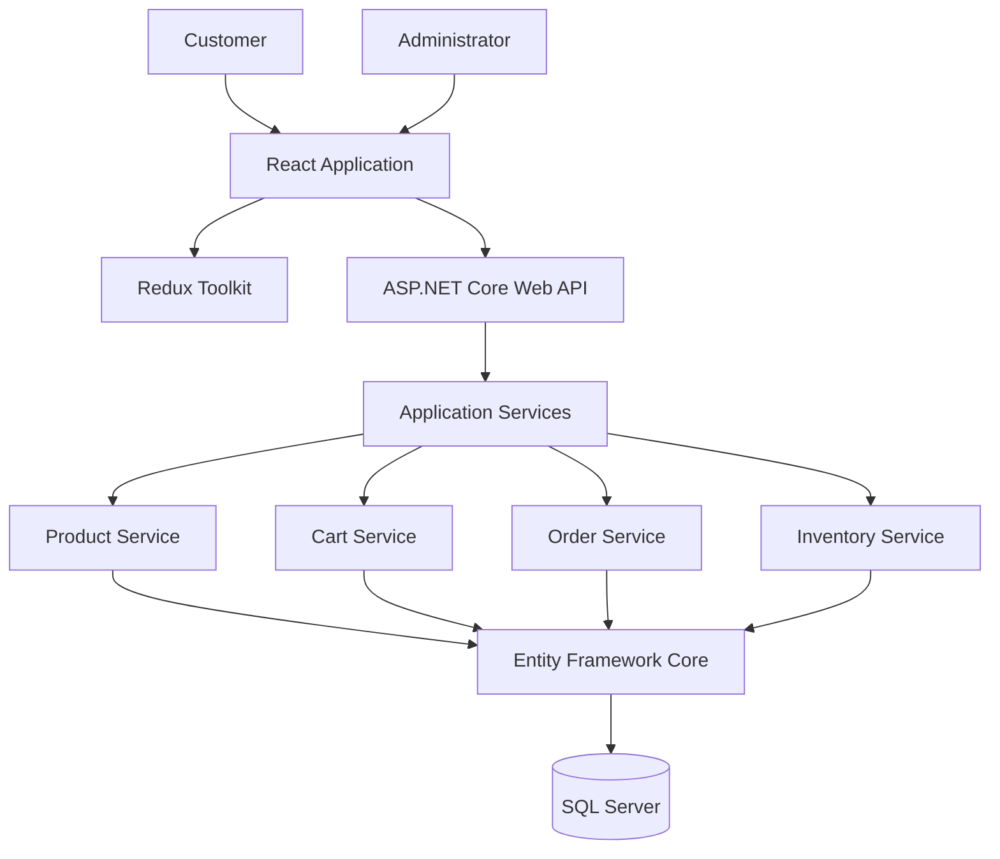
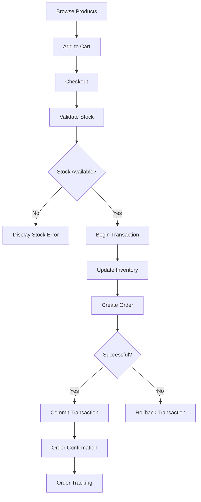
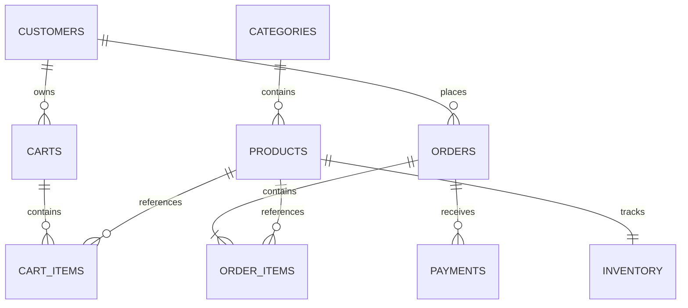
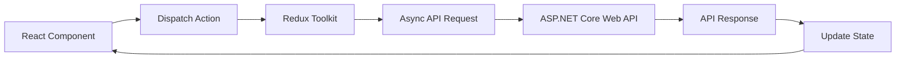

# ShopStream - E-commerce Platform

## Project Information

| Parameter | Details |
|---|---|
| Domain | Retail & E-commerce |
| Organization | Enrichepro Software Pvt. Ltd. |
| Role | Full Stack .NET Developer |
| Project Type | Enterprise Web Application |
| Frontend | React.js, TypeScript |
| Backend | ASP.NET Core Web API |
| Database | Microsoft SQL Server |
| ORM | Entity Framework Core |
| State Management | Redux Toolkit |

## Project Overview

ShopStream is an enterprise e-commerce platform supporting
product catalog management, shopping carts, checkout,
order processing, order tracking, and inventory management.

The application focuses on reusable frontend components,
efficient backend services, and inventory consistency
during concurrent order processing.

## Technology Stack

- C#, ASP.NET Core Web API
- React.js, TypeScript, JavaScript
- Redux Toolkit, React Hooks
- HTML5, CSS3
- SQL Server, Entity Framework Core, LINQ
- RESTful APIs

## Key Functional Modules

- Product Catalog Management
- Product Search and Filtering
- Customer Management
- Shopping Cart
- Checkout Management
- Order Processing
- Order Tracking
- Inventory Management
- Administration Dashboard

## Roles and Responsibilities

- Developed reusable React and TypeScript components.
- Implemented centralized state management using Redux Toolkit.
- Developed RESTful APIs for e-commerce workflows.
- Contributed to shopping cart and checkout functionality.
- Implemented order and inventory management operations.
- Developed database operations using EF Core and SQL Server.
- Contributed to inventory consistency and concurrency handling.
- Participated in application debugging and maintenance.

## Illustrative System Architecture



## Order Processing Workflow



## Reference Database Design



## Reference REST API Endpoints

| Method | Endpoint | Purpose |
|---|---|---|
| GET | /api/products | Product catalog |
| GET | /api/products/{id} | Product details |
| POST | /api/products | Create product |
| PUT | /api/products/{id} | Update product |
| GET | /api/cart | Retrieve cart |
| POST | /api/cart/items | Add cart item |
| PUT | /api/cart/items/{id} | Update quantity |
| DELETE | /api/cart/items/{id} | Remove item |
| POST | /api/orders | Create order |
| GET | /api/orders/{id} | Order details |
| GET | /api/inventory/{productId} | Stock availability |
| PATCH | /api/orders/{id}/status | Update order status |

## Inventory Concurrency Handling

Multiple customers may attempt to purchase the same
product simultaneously. Without concurrency control,
orders may exceed available inventory.

### Illustrative Scenario

| Parameter | Value |
|---|---|
| Available Stock | 5 Units |
| Customer A Request | 4 Units |
| Customer B Request | 3 Units |
| Total Requested | 7 Units |
| Expected Behavior | Prevent Overselling |

### Reference SQL Implementation

```sql
UPDATE Inventory
SET AvailableQuantity = AvailableQuantity - @Quantity
WHERE ProductId = @ProductId
  AND @Quantity > 0
  AND AvailableQuantity >= @Quantity;
```

If the affected row count is zero, the inventory
reservation has failed.

Inventory updates and order creation should be
coordinated within the same database transaction.

## Redux Toolkit State Management

```text
store/
├── store.ts
├── productSlice.ts
├── cartSlice.ts
├── orderSlice.ts
└── customerSlice.ts
```



## Security Considerations

- Secure authentication and authorization
- Server-side price validation
- Server-side inventory validation
- Protected customer information
- Parameterized SQL queries
- HTTPS communication
- Restricted administrative operations

## Recommended Testing Strategy

- Product availability testing
- Shopping cart calculation testing
- Checkout validation
- Concurrent order processing tests
- Database transaction rollback tests
- Redux state management tests
- API integration testing

## Engineering Practices

- Component-Based Architecture
- Centralized State Management
- SOLID Principles
- Dependency Injection
- RESTful API Design
- Transactional Data Integrity

## Potential Enhancements

- Redis distributed caching
- Payment gateway integration
- Automated order notifications
- Product recommendation engine
- Advanced sales analytics
- Docker and CI/CD demonstrations

These enhancements are proposed ideas.

## Confidentiality Notice

This case study summarizes professional project experience.
Architecture diagrams, SQL examples, database models,
and API endpoints are illustrative reference designs.

No proprietary source code, customer information,
credentials, or confidential company data is included.

## Author

**Saurabh Kirulkar | Full Stack .NET Developer**

[GitHub](https://github.com/Saurabhk0501) |
[LinkedIn](https://www.linkedin.com/in/connectsaurabhk07)

[Back to Technical Portfolio](../README.md)

