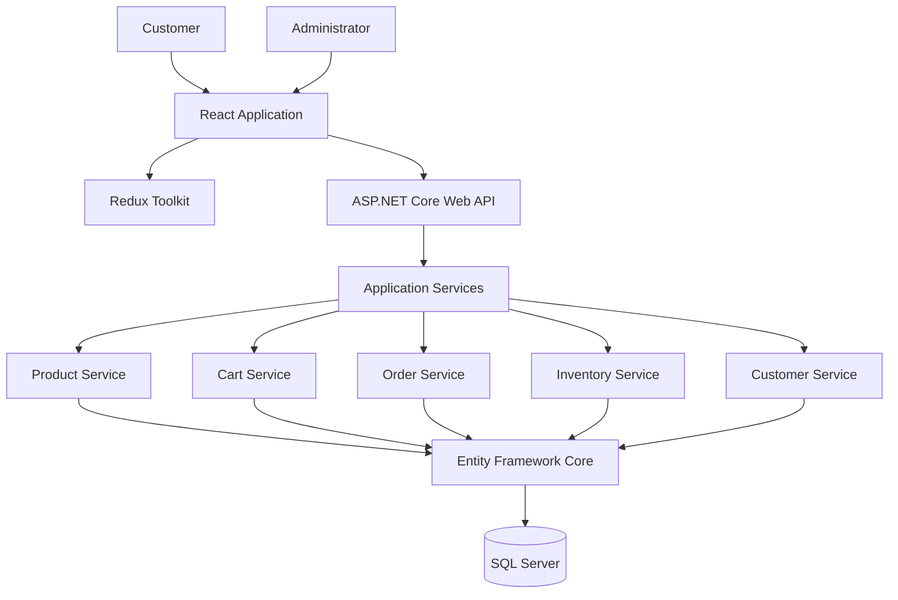
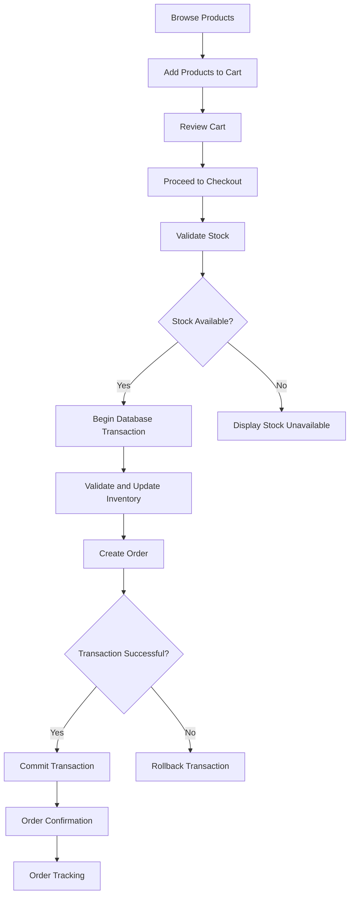
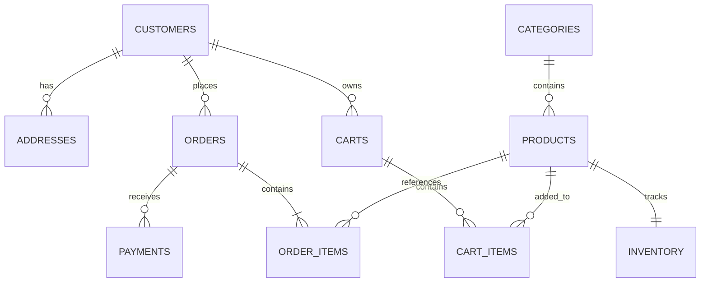
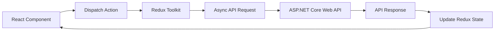

# ShopStream - E-commerce Platform

## 1. Project Information

| Parameter | Details |
|---|---|
| Project Name | ShopStream |
| Domain | Retail & E-commerce |
| Organization | Enrichepro Software Pvt. Ltd. |
| Role | Full Stack .NET Developer |
| Project Type | Enterprise Application |
| Frontend | React.js |
| Backend | ASP.NET Core Web API |
| Language | C#, TypeScript |
| Database | Microsoft SQL Server |
| ORM | Entity Framework Core |
| State Management | Redux Toolkit |

---

## 2. Project Overview

ShopStream is an enterprise e-commerce platform
designed to support product catalog management,
shopping carts, checkout, order processing,
order tracking, and inventory management.

The application focuses on responsive user
interfaces, reusable backend services, efficient
data management, and inventory consistency
during concurrent order processing.

---

## 3. Business Objectives

- Provide a seamless online shopping experience.
- Simplify product catalog management.
- Streamline shopping cart and checkout workflows.
- Manage customer orders and order status.
- Maintain accurate inventory records.
- Prevent overselling during concurrent orders.
- Improve application maintainability and scalability.

---

## 4. Technology Stack

### Backend

- C#
- ASP.NET Core Web API
- Entity Framework Core
- LINQ
- RESTful APIs
- Dependency Injection

### Frontend

- React.js
- TypeScript
- Redux Toolkit
- React Hooks
- JavaScript
- HTML5
- CSS3

### Database

- Microsoft SQL Server
- T-SQL
- Relational Database Design
- Transaction Management
- Concurrency Handling

---

## 5. Functional Modules

The following modules describe the application
scope and representative e-commerce workflows.

### Product Management

- Product catalog management
- Product categories
- Product details
- Product search and filtering
- Product availability

### Shopping Cart

- Add products to cart
- Update product quantities
- Remove products from cart
- Calculate order totals
- Validate product availability

### Customer Management

- Customer information management
- Customer profile
- Order history
- Shipping information

### Order Management

- Checkout processing
- Order creation
- Order status management
- Order tracking
- Order history

### Inventory Management

- Stock availability tracking
- Inventory updates
- Stock validation
- Concurrent order handling
- Overselling prevention

### Administration

- Product management
- Inventory monitoring
- Order monitoring
- Customer management

---

## 6. Professional Contributions

- Developed reusable frontend components using
  React.js and TypeScript.

- Implemented centralized state management
  using Redux Toolkit.

- Developed RESTful APIs using ASP.NET Core
  Web API for product, customer, order,
  and inventory operations.

- Implemented shopping cart, checkout,
  and order management workflows.

- Developed database operations using
  Entity Framework Core and SQL Server.

- Implemented inventory consistency and
  concurrency handling to prevent overselling
  during simultaneous order processing.

- Contributed to maintainable application
  development through reusable components,
  backend services, and separation of concerns.

---

## 7. Illustrative System Architecture



This diagram represents an illustrative logical
architecture for portfolio documentation.

---

## 8. Illustrative Order Processing Workflow



The workflow illustrates a possible transaction-based
approach to order processing and inventory consistency.

---

## 9. Reference Database Design

The following entities represent a simplified
conceptual e-commerce database model.

| Entity | Responsibility |
|---|---|
| Customers | Customer information |
| Categories | Product categories |
| Products | Product catalog |
| Inventory | Available stock |
| Carts | Customer shopping carts |
| CartItems | Shopping cart products |
| Orders | Customer order records |
| OrderItems | Ordered product details |
| Payments | Payment records |
| Addresses | Customer shipping addresses |

### Conceptual Entity Relationship Diagram



---

## 10. Reference REST API Design

The following endpoints are illustrative examples
of RESTful API design for an e-commerce application.

| Method | Endpoint | Purpose |
|---|---|---|
| GET | /api/products | List products |
| GET | /api/products/{id} | Product details |
| POST | /api/products | Create product |
| PUT | /api/products/{id} | Update product |
| GET | /api/categories | List categories |
| GET | /api/cart | Retrieve shopping cart |
| POST | /api/cart/items | Add product to cart |
| PUT | /api/cart/items/{id} | Update cart quantity |
| DELETE | /api/cart/items/{id} | Remove cart item |
| POST | /api/orders | Create order |
| GET | /api/orders/{id} | Order details |
| GET | /api/orders | Authorized order history |
| GET | /api/inventory/{productId} | Check stock |
| PATCH | /api/orders/{id}/status | Update order status |

Administrative endpoints require appropriate
authorization and access controls.

---

## 11. Inventory Concurrency Handling

### Business Problem

Multiple customers may attempt to purchase
the same product simultaneously.

Without proper concurrency handling, multiple
requests may read the same available stock
and create orders that exceed actual inventory.

### Illustrative Scenario

| Parameter | Value |
|---|---|
| Available Stock | 5 Units |
| Customer A Request | 4 Units |
| Customer B Request | 3 Units |
| Total Requested | 7 Units |
| Expected Result | Prevent Overselling |

If Customer A successfully purchases four units,
the remaining stock is one unit.

Customer B's request for three units must be
rejected or adjusted according to business rules.

### Reference Concurrency Strategy

- Validate stock at checkout.
- Use database transactions.
- Perform atomic conditional inventory updates.
- Apply optimistic concurrency where appropriate.
- Handle concurrency conflicts.
- Roll back failed order transactions.
- Return meaningful error responses.

### Illustrative SQL Example

```sql
UPDATE Inventory
SET AvailableQuantity = AvailableQuantity - @Quantity
WHERE ProductId = @ProductId
  AND AvailableQuantity >= @Quantity;
```

If the affected row count is zero, the requested
quantity cannot be reserved or the inventory
record does not exist.

The inventory update and order creation should
be coordinated within the same database transaction.

This example is an independent reference design,
not proprietary production source code.

---

## 12. Frontend State Management

Redux Toolkit provides centralized state
management for shared application data.

### Illustrative Redux Store Structure

```text
store/
├── store.ts
├── productSlice.ts
├── cartSlice.ts
├── orderSlice.ts
└── customerSlice.ts
```

### State Management Responsibilities

| State | Responsibility |
|---|---|
| Product State | Product catalog and filters |
| Cart State | Cart items and quantities |
| Order State | Order status and history |
| Customer State | Customer information |
| Loading State | API request progress |
| Error State | Application error messages |

### Illustrative Data Flow



---

## 13. Security Considerations

Recommended security practices for an
e-commerce application include:

- Secure authentication and authorization
- Role-based administrative access
- Server-side input validation
- Protected customer information
- HTTPS communication
- Parameterized database operations
- Secure API endpoints
- Server-side price and stock validation
- Secure handling of payment information

Sensitive payment card information should not
be stored directly by the application unless
appropriate compliance requirements are met.

---

## 14. Recommended Testing Strategy

### Backend Testing

- Product availability validation
- Shopping cart calculations
- Order creation
- Inventory updates
- Transaction rollback
- Concurrent order processing
- Insufficient stock handling

### Frontend Testing

- Product catalog rendering
- Shopping cart interactions
- Redux state updates
- Checkout form validation
- API error handling
- Order confirmation

### Integration Testing

- Product and inventory integration
- Checkout and order processing
- Database transaction consistency
- Concurrent purchase scenarios

---

## 15. Performance Considerations

- Database indexing
- Efficient SQL queries
- Pagination for product listings
- Optimized data retrieval
- Reusable React components
- Efficient state management
- Reduced unnecessary API requests
- Appropriate transaction boundaries

These are reference engineering considerations
rather than measured production achievements.

---

## 16. Engineering Principles

- Separation of Concerns
- SOLID Principles
- Dependency Injection
- RESTful API Design
- Component-Based Development
- Centralized State Management
- Transactional Data Integrity
- Maintainable Business Logic

---

## 17. Potential Future Enhancements

- Payment gateway integration
- Redis-based distributed caching
- Product recommendation engine
- Discount and coupon management
- Automated order notifications
- Advanced sales analytics
- Background job processing
- Automated CI/CD pipelines
- Cloud-based application deployment

These enhancements are proposed ideas and
are not represented as completed features.

---

## 18. Confidentiality Notice

ShopStream represents professional project experience.

This case study contains high-level functional
descriptions and illustrative technical designs.

Architecture diagrams, database models, API endpoints,
SQL examples, and concurrency strategies are
independent reference designs.

They do not disclose proprietary production
implementations, confidential company source code,
customer data, credentials, or internal information.

---

## Author

**Saurabh Kirulkar**

Full Stack .NET Developer

- GitHub: [Saurabhk0501](https://github.com/Saurabhk0501)
- LinkedIn: [Saurabh Kirulkar](https://www.linkedin.com/in/connectsaurabhk07)

[Back to Technical Portfolio](../README.md)
